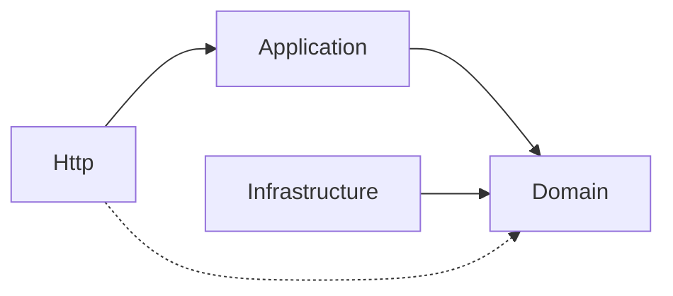

# Capas del backend

Cada módulo de la API (`app/Modules/<Módulo>`) se divide en cuatro capas. Las dependencias solo apuntan hacia adentro: el dominio no conoce a nadie y todo lo demás puede usarlo.

| Capa | Contiene | No puede usar |
|---|---|---|
| **Domain** | Reglas de negocio, enums, excepciones de dominio, contratos (interfaces) | Laravel, ni ninguna otra capa |
| **Application** | Casos de uso, DTOs y servicios de consulta | La capa Http, el request de Laravel ni Eloquent |
| **Infrastructure** | Modelos Eloquent, repositorios, caché, integraciones | — |
| **Http** | Controladores delgados, FormRequests, Resources, Policies, rutas del módulo | Consultas directas a la base de datos |

Lo transversal vive en el módulo `Shared` con la misma división.

## Cómo se garantiza

Las reglas de la tabla no dependen de la disciplina de cada persona: la prueba de arquitectura recorre todos los módulos y falla si alguna capa usa algo que no le corresponde. Además verifica que todo el código use tipos estrictos, que no queden funciones de depuración y que las variables de entorno se lean solo desde `config/`.

## Dónde está en el código

- [`backend/app/Modules/`](../../backend/app/Modules/): módulos.
- [`backend/tests/Arch/ArchitectureTest.php`](../../backend/tests/Arch/ArchitectureTest.php): reglas de arquitectura.
- Decisiones: [ADR-0001](../decisiones/0001-monolito-modular.md) y [ADR-0002](../decisiones/0002-cqrs-ligero.md).
