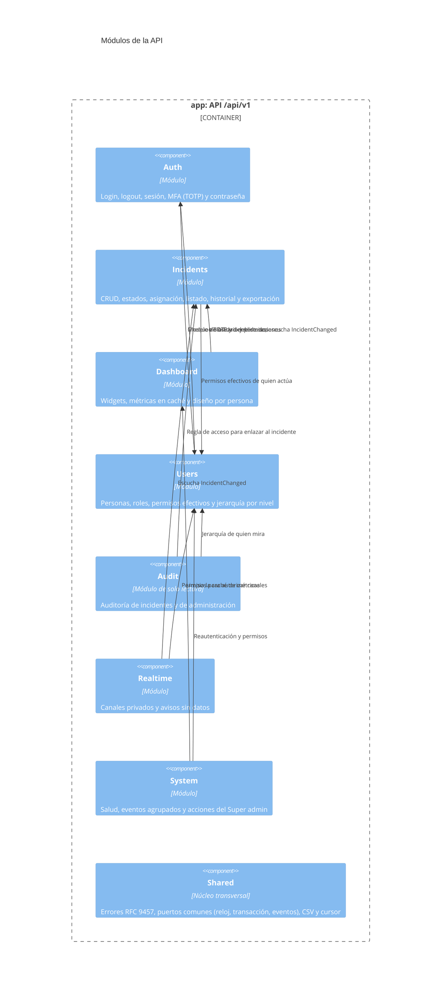
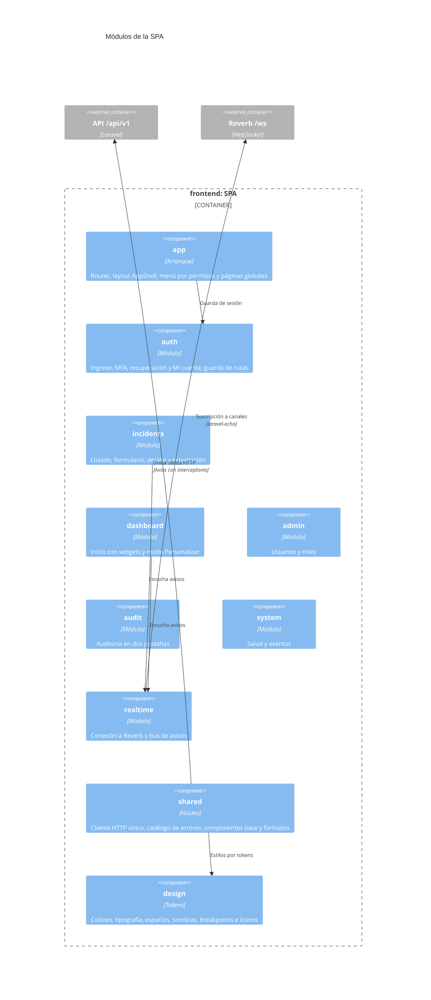

# Componentes

Nivel 3 del modelo C4: los módulos dentro de la API y de la SPA. Cada módulo de la API tiene sus cuatro [capas](capas.md), y cada módulo de la SPA tiene `domain`, `application`, `infrastructure` y `presentation`.

## API (Laravel)

Todos los módulos usan `Shared`; esas flechas se omiten para que el diagrama se pueda leer.

### Cómo se comunican

| De | A | Qué usa | Por qué |
|---|---|---|---|
| Incidents, Realtime, System | Users | `UserPermissions` / `EffectivePermissions` | Una sola fuente de permisos efectivos (rol + concedidos − quitados), calculada una vez por petición |
| Incidents | Users | `PermissionSql` | La misma regla de permisos en SQL, para listar a quién se puede asignar |
| Dashboard | Incidents | `VisibilityScope` + `VisibilitySql` y evento `IncidentChanged` | Una cifra del dashboard y el listado nunca pueden contar distinto; cada cambio invalida la caché de métricas |
| Audit | Incidents | `IncidentAccess` (dominio) | El enlace al incidente solo aparece si quien mira puede verlo |
| Realtime | Incidents | Evento `IncidentChanged` | Incidents no conoce a Realtime: emite un evento y Realtime decide a qué canales avisar |
| System | Dashboard | Puerto `MetricsCache` | Limpiar la caché de datos sin tocar los contadores de seguridad |
| Users ↔ Auth | | `TotpCheck`, `SessionTokens` / modelo `User` | Users reautentica con el TOTP y cierra sesiones al desactivar; Auth lee la persona y sus permisos |
| Todos | Shared | Puertos `Clock`, `Transaction`, `SystemEvents`, `AdminLog`, `SessionSignals` | Lo transversal se define una vez |

**Dependencia mutua Users ↔ Auth.** Hoy los dos módulos se usan entre sí. Funciona y lo cubren las pruebas, pero si se quisiera separar uno de ellos (por ejemplo, llevar la autenticación a un proveedor externo), lo primero sería mover el chequeo TOTP y el cierre de sesiones a puertos de `Shared`, como ya se hizo con `SessionSignals`.

### Escrituras y lecturas

- **Escrituras:** controlador → caso de uso (`Application`) → reglas del dominio → repositorio (`Infrastructure`), dentro de una transacción. Los eventos (`IncidentChanged`) salen después del commit.
- **Lecturas pesadas** (listado, dashboard, auditoría, eventos): controlador → query service con SQL afinado e índices validados con `EXPLAIN` ([ADR-0002](../decisiones/0002-cqrs-ligero.md)).

## SPA (Vue)

- **Las vistas nunca llaman a la API.** Cada módulo tiene su `infrastructure/*Api.ts` (por ejemplo `incidentsApi.ts` o `usersApi.ts`), que usa el cliente único de `shared/http`. El cliente agrega el token y el `X-Request-Id`, reintenta los GET ante fallas de red y avisa de la sesión vencida o del mantenimiento.
- **El front no decide permisos.** Muestra u oculta acciones según el `actions` que trae cada recurso, y el menú según los permisos de la sesión.
- **Quasar queda en la presentación.** Los componentes base de `shared/ui` lo envuelven, y los estilos salen solo de los tokens de `design/` (lo exige Stylelint).
- **Rutas por módulo.** Cada módulo declara lo que necesita (`routes.ts`, `navigation.ts`, `errors.ts`) y todo se registra solo al arrancar, con carga diferida por ruta. `realtime` no tiene pantallas: solo la conexión y el bus.

## Dónde está en el código

- [`backend/app/Modules/`](../../backend/app/Modules/): módulos de la API.
- [`backend/tests/Arch/ArchitectureTest.php`](../../backend/tests/Arch/ArchitectureTest.php): reglas de capas.
- [`frontend/src/modules/`](../../frontend/src/modules/), [`frontend/src/shared/`](../../frontend/src/shared/) y [`frontend/src/design/`](../../frontend/src/design/): SPA.
- [`frontend/src/app/`](../../frontend/src/app/): arranque, router y layout.
- Detalle por módulo: [backend](../backend/index.md) y [frontend](../frontend/index.md).
- Decisiones: [ADR-0001](../decisiones/0001-monolito-modular.md), [ADR-0002](../decisiones/0002-cqrs-ligero.md) y [ADR-0003](../decisiones/0003-frontend-modular.md).
