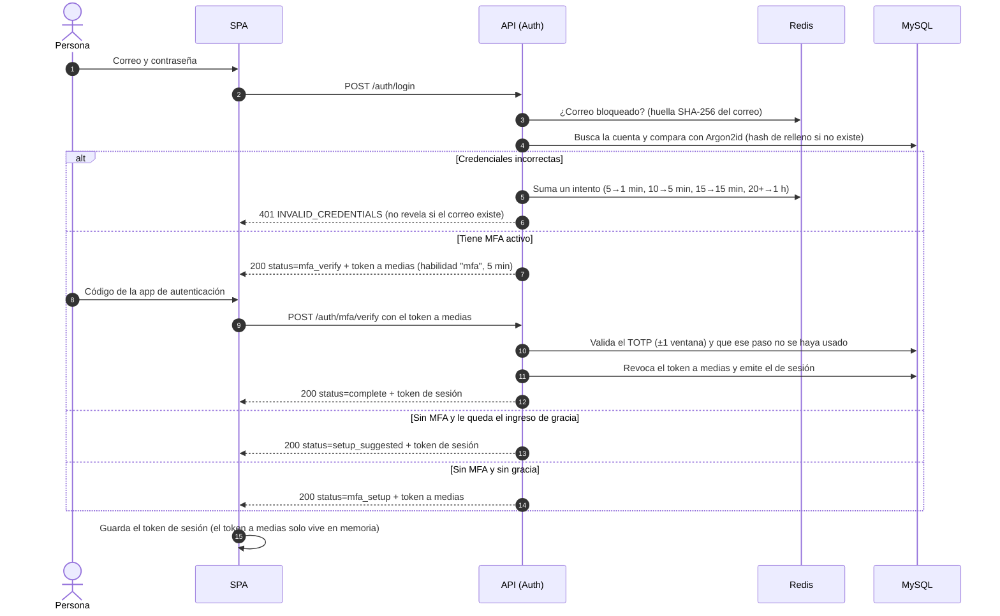
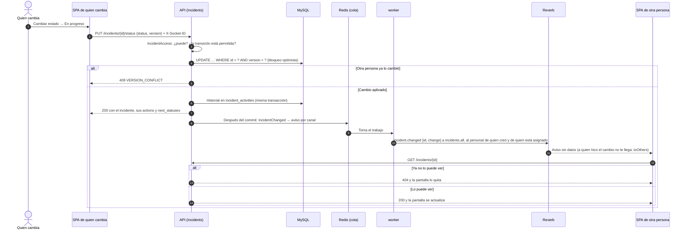
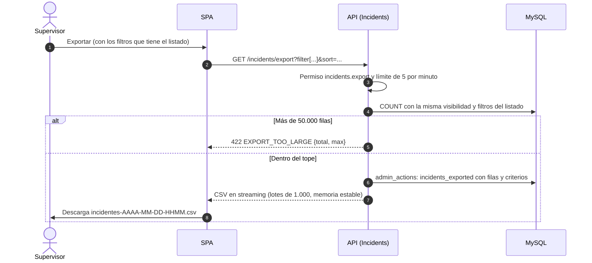

# Flujos principales

Tres recorridos que cruzan varias piezas del sistema. El detalle de cada endpoint está en el documento de su módulo.

## Ingreso con verificación en dos pasos

- El token a medias solo sirve para las rutas `auth.mfa.challenge.*` y para `logout`. El callback de Sanctum lo rechaza en cualquier otra ruta.
- Cinco códigos fallidos en un mismo ingreso revocan el token a medias (`MFA_TOO_MANY_ATTEMPTS`) y dejan un evento del sistema.
- La sesión dura 8 horas como máximo y se cierra tras 1 hora sin uso ([ADR-0042](../decisiones/0042-sesion-y-bloqueo.md), [ADR-0051](../decisiones/0051-mfa-en-la-practica.md)).

## Cambio de estado con aviso en tiempo real

- Los avisos no llevan datos: solo el id y el tipo de cambio. Cada pantalla vuelve a pedir el recurso a la API, que aplica los permisos de quien mira ([ADR-0057](../decisiones/0057-tiempo-real-en-la-practica.md)).
- El mismo `IncidentChanged` sube la generación de la caché del dashboard, así que las cifras nuevas se calculan en la siguiente consulta.
- Si Reverb o el worker están caídos, el cambio igual se guarda. La otra persona ve el dato actualizado al recargar, y `system:check` deja un evento del sistema.

## Exportación a CSV

- El archivo sale listo para Excel en español: BOM, separador `;` y fechas en la zona horaria del negocio.
- Las celdas que empiezan con `=`, `+`, `-`, `@`, tabulador o salto de línea llevan un apóstrofo al inicio, para que la hoja de cálculo no las ejecute como fórmula ([ADR-0058](../decisiones/0058-exportacion-en-la-practica.md)).

## Dónde está en el código

- Ingreso: [`AuthController`](../../backend/app/Modules/Auth/Http/AuthController.php), [`MfaController`](../../backend/app/Modules/Auth/Http/MfaController.php) y [`VerifyMfa`](../../backend/app/Modules/Auth/Application/Mfa/VerifyMfa.php).
- Cambio de estado: [`IncidentWorkflowController`](../../backend/app/Modules/Incidents/Http/IncidentWorkflowController.php), [`ChangeIncidentStatus`](../../backend/app/Modules/Incidents/Application/ChangeIncidentStatus.php) y [`EloquentIncidentRepository`](../../backend/app/Modules/Incidents/Infrastructure/EloquentIncidentRepository.php).
- Tiempo real: [`backend/app/Modules/Realtime/`](../../backend/app/Modules/Realtime/) y [`frontend/src/modules/realtime/`](../../frontend/src/modules/realtime/).
- Exportación: [`IncidentController`](../../backend/app/Modules/Incidents/Http/IncidentController.php), [`IncidentCsv`](../../backend/app/Modules/Incidents/Http/IncidentCsv.php) y [`CsvDownload`](../../backend/app/Modules/Shared/Http/CsvDownload.php).
