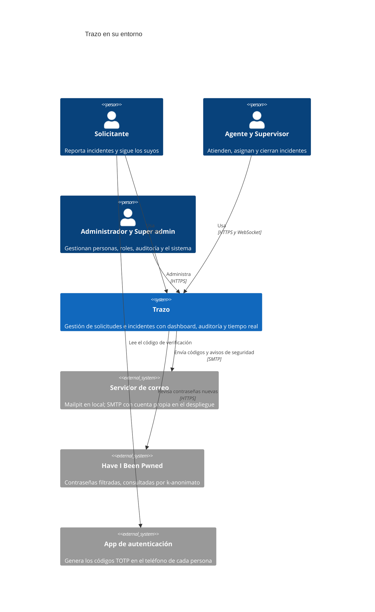
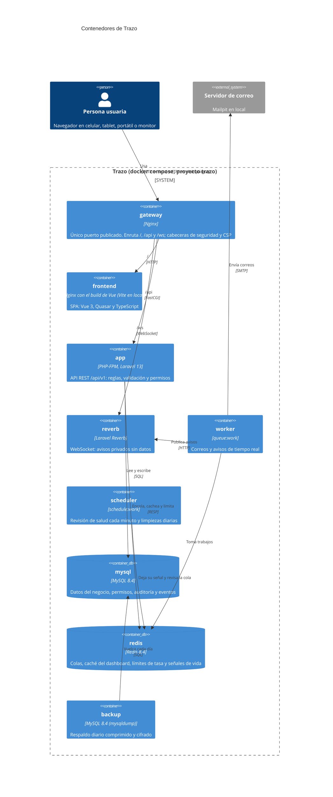
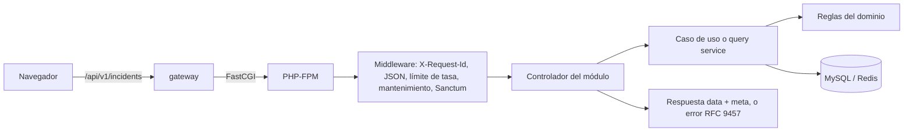

# Vista general

Trazo es una SPA en Vue que consume una API REST en Laravel. Las dos quedan detrás de un gateway Nginx, que es el único punto de entrada. Los diagramas siguen el modelo C4: primero el sistema en su entorno y después los contenedores que lo forman. Los componentes de cada contenedor están en [componentes](componentes.md).

## Nivel 1: contexto

Quién usa Trazo y con qué sistemas externos habla.

- **Correo:** códigos de recuperación de contraseña, bienvenida a cuentas nuevas y avisos de seguridad. Si el correo falla, el trabajo queda en la cola para reintentarse y nada se bloquea.
- **Have I Been Pwned:** solo recibe los primeros 5 caracteres del SHA-1 de la contraseña, nunca la contraseña. Si no responde en 3 segundos, se usa solo la lista local y queda un evento del sistema.
- **App de autenticación:** no hay conexión con ella. Comparte con Trazo un secreto al configurar el MFA y desde ahí genera códigos sin red.

## Nivel 2: contenedores

Cada caja es un servicio del [docker-compose.yml](../../docker-compose.yml). Todos los servicios de Laravel usan la misma imagen y solo cambia el comando.

El navegador pide la firma de cada canal privado a la API (`POST /api/v1/broadcasting/auth`, con su token de sesión) y se la presenta a Reverb al suscribirse. Reverb nunca consulta a la API: solo verifica la firma.

| Contenedor | Por qué existe por separado |
|---|---|
| `gateway` | Un solo origen para la SPA, la API y el WebSocket: sin CORS, con una sola CSP y un solo lugar para TLS |
| `frontend` | El build de Vue se sirve como archivos estáticos, sin PHP de por medio |
| `app` | La API es la única autoridad: toda regla, permiso y cálculo vive aquí |
| `worker` | Correos y avisos salen de la petición: la respuesta no espera al servidor de correo |
| `scheduler` | Tareas periódicas en un proceso propio, con su señal de vida |
| `reverb` | Conexiones largas aisladas de PHP-FPM |
| `mysql` y `redis` | En una red interna sin salida ni puertos publicados |
| `backup` | El respaldo de la base no depende de que la app esté viva; usa la imagen de MySQL y el usuario de la app ([Respaldos](../operacion/respaldos.md)) |

Además, `init` corre las migraciones y los seeders en cada arranque y termina. El resto de los servicios de Laravel espera a que acabe bien. En local se suma `mailpit` (buzón de prueba) y, de forma opcional, `zap` (escaneo de seguridad, perfil `zap`).

## El camino de una petición

1. El gateway agrega las cabeceras de seguridad y pasa la petición a PHP-FPM.
2. Primero se asigna el `X-Request-Id` y se fuerza JSON en toda petición. Después, el grupo de la API aplica el límite de tasa, revisa el modo mantenimiento y vigila los 403 repetidos. Al final, cada ruta protegida valida el token de Sanctum.
3. El controlador valida la entrada y llama al caso de uso (escrituras) o al query service (lecturas pesadas).
4. Las reglas de acceso y de estado están en el dominio. Si alguna se rompe, se lanza una excepción de dominio, y `ApiExceptionRenderer` la convierte en un error RFC 9457 con su código.

## Redes y puertos

| Red | Servicios | Salida a internet |
|---|---|---|
| `edge` | gateway, frontend, app, worker, scheduler, reverb, init (y mailpit en local) | Sí |
| `data` | mysql, redis, backup y los servicios de Laravel | No (`internal: true`) |

Solo el gateway publica un puerto (`TRAZO_HTTP_PORT`, 8088 por defecto). En local también se publica el de Mailpit (`TRAZO_MAIL_UI_PORT`, 8025). Cada contenedor tiene un límite de CPU y memoria, y todos los nombres llevan el prefijo `trazo` para convivir con otros proyectos en la misma máquina.

## Dónde está en el código

- [`docker-compose.yml`](../../docker-compose.yml) y [`docker-compose.override.yml`](../../docker-compose.override.yml): servicios, redes, volúmenes y límites.
- [`docker/nginx/gateway.conf`](../../docker/nginx/gateway.conf): enrutamiento del gateway.
- [`docker/nginx/snippets/`](../../docker/nginx/snippets/): cabeceras de seguridad y CSP.
- [`backend/bootstrap/app.php`](../../backend/bootstrap/app.php): middleware y manejo de errores.
- Decisiones: [ADR-0001](../decisiones/0001-monolito-modular.md), [ADR-0025](../decisiones/0025-docker.md) y [ADR-0057](../decisiones/0057-tiempo-real-en-la-practica.md).
- Operación de los servicios: [Docker](../operacion/docker.md).
