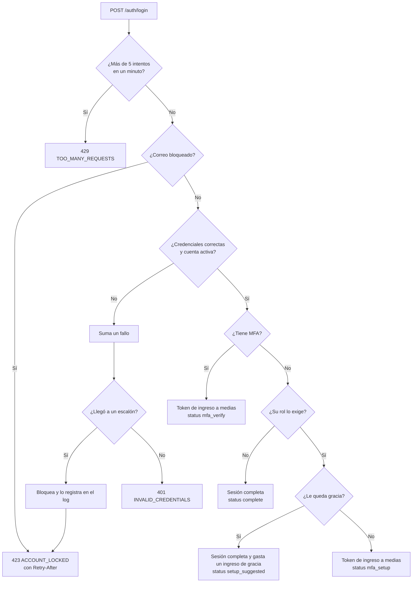

# Módulo Auth

Se encarga de comprobar quién es la persona y de mantener su sesión. Los permisos de cada acción los resuelve cada módulo con sus Policies; Auth solo entrega la lista de permisos del usuario para que el front arme el menú.

## Endpoints

| Método | Ruta | Sesión | Límite | Respuesta |
|---|---|---|---|---|
| `POST` | `/api/v1/auth/login` | No | 5 por minuto (correo + IP) | Token, vencimiento y usuario |
| `POST` | `/api/v1/auth/logout` | Sí | General | `204` y el token queda revocado |
| `GET` | `/api/v1/auth/me` | Sí | General | Usuario con roles, permisos y estado del MFA |
| `POST` | `/api/v1/auth/mfa/verify` | Ingreso a medias | 5 por minuto | Segundo paso: `code` o `recovery_code`; devuelve la sesión completa |
| `POST` | `/api/v1/auth/mfa/setup` | Ingreso a medias o sesión | General | Clave nueva sin confirmar y su dirección `otpauth://` para el QR |
| `POST` | `/api/v1/auth/mfa/setup/confirm` | Ingreso a medias o sesión | 5 por minuto | Activa el MFA con el primer `code`; devuelve los 8 códigos de recuperación y, si venía de un ingreso a medias, la sesión completa |
| `POST` | `/api/v1/auth/mfa/recovery-codes` | Sí | 5 por minuto | Con un `code` actual, 8 códigos nuevos; los anteriores dejan de servir |
| `DELETE` | `/api/v1/auth/mfa` | Sí | 5 por minuto | Con un `code` actual, desactiva el MFA si la política del rol no lo exige |

Todas las rutas de la API tienen además el límite general de 120 peticiones por minuto, por usuario o por IP.

```json
POST /api/v1/auth/login
{ "email": "agente1@trazo.test", "password": "••••••••••••" }

200 OK
{
  "data": {
    "status": "complete",
    "token": "12|trazo_…",
    "token_type": "Bearer",
    "expires_at": "2026-10-22T20:54:28+00:00",
    "user": {
      "id": "01m5fr6tp5p0cbwjtjwdsst5n0",
      "name": "Laura Gómez",
      "email": "agente1@trazo.test",
      "roles": [{ "code": "agent", "name": "Agente" }],
      "permissions": ["dashboard.view.own", "incidents.create", "…"],
      "mfa": { "enabled": true, "required": true, "recovery_codes_left": 8 }
    }
  }
}
```

`status` dice qué sigue después de la contraseña:

| `status` | Token | `user` | Qué hace el front |
|---|---|---|---|
| `complete` | Sesión completa | Sí | Entra |
| `setup_suggested` | Sesión completa | Sí | Entra, pero ofrece configurar el MFA con "Configurar más tarde" (usa un ingreso de gracia) |
| `mfa_verify` | Ingreso a medias | `null` | Pide el código de la aplicación |
| `mfa_setup` | Ingreso a medias | `null` | Exige configurar el MFA para entrar |

## Flujo del login



## Errores

| Código | Estado | Cuándo | Parámetros |
|---|---|---|---|
| `INVALID_CREDENTIALS` | 401 | Contraseña incorrecta, correo inexistente o cuenta inactiva | — |
| `ACCOUNT_LOCKED` | 423 | Demasiados fallos seguidos con ese correo | `retry_after` (segundos), también en la cabecera `Retry-After` |
| `TOO_MANY_REQUESTS` | 429 | Más de 5 intentos por minuto con el mismo correo desde la misma IP | Cabecera `Retry-After` |
| `UNAUTHENTICATED` | 401 | Sin token, con un token revocado, vencido o inactivo, o con el token de un ingreso a medias fuera de las rutas del segundo paso | — |
| `MFA_CODE_INVALID` | 422 | El código de la aplicación no es correcto | `attempts_left`, durante el ingreso |
| `MFA_CODE_ALREADY_USED` | 422 | Era un código correcto, pero ya se había usado | — |
| `MFA_RECOVERY_CODE_INVALID` | 422 | El código de recuperación no existe o ya se usó | `attempts_left` |
| `MFA_TOO_MANY_ATTEMPTS` | 401 | Quinto código incorrecto en el mismo ingreso: se revoca el token | — |
| `MFA_ALREADY_ENABLED` | 409 | Configurar el MFA cuando ya está activo | — |
| `MFA_NOT_ENABLED` | 409 | Verificar, regenerar o desactivar sin MFA activo | — |
| `MFA_SETUP_NOT_STARTED` | 409 | Confirmar sin haber pedido antes una clave | — |
| `MFA_REQUIRED_BY_POLICY` | 409 | Desactivar el MFA cuando el rol lo exige | — |
| `MFA_NOT_PENDING` | 409 | Verificar un código con una sesión que ya está completa | — |

## Reglas de seguridad

### No revelar qué cuentas existen
- El mismo `INVALID_CREDENTIALS` sirve para la contraseña incorrecta, el correo que no existe y la cuenta inactiva. Las tres respuestas son idénticas, salvo el `trace_id`.
- **Mismo tiempo de respuesta.** Si el correo no existe, la contraseña se verifica igual contra un hash de relleno con los mismos parámetros de Argon2id. Así, el tiempo de respuesta no delata nada.
- **El bloqueo se aplica por correo, exista o no la cuenta.** Si solo se bloquearan las cuentas reales, "cuenta bloqueada" confirmaría que ese correo existe.

### Bloqueo progresivo
| Fallos seguidos | Espera |
|---|---|
| 5 | 1 minuto |
| 10 | 5 minutos |
| 15 | 15 minutos |
| 20 o más | 1 hora en cada fallo |

- Mientras dure el bloqueo, ni siquiera la contraseña correcta permite ingresar.
- Un ingreso correcto reinicia el contador. Si no, el contador vence 24 horas después del primer fallo.
- **Dónde vive:** en Redis, con la huella SHA-256 del correo como clave, nunca el correo en claro.
- **Ajustes:** los escalones son datos en `config/trazo.php`.
- **Registro en el log:** cada bloqueo se registra como advertencia, con la huella, la IP y la cantidad de fallos. Los fallos aislados no se registran, para no llenar el log de ruido.

### Sesión
| Regla | Valor | Dónde se cambia |
|---|---|---|
| Duración máxima | 8 horas desde el ingreso | `SESSION_MAX_MINUTES` |
| Inactividad | Se cierra tras 1 hora sin peticiones | `SESSION_IDLE_MINUTES` |
| Cuenta desactivada | Sus sesiones abiertas dejan de valer en la siguiente petición | — |
| Cierre de sesión | El token se borra en el servidor | — |

- **Tokens:**
  - Se guarda solo el hash SHA-256 del token. El valor en claro se entrega una única vez, al iniciar sesión.
  - Los tokens llevan el prefijo `trazo_`, para que los escáneres de secretos los reconozcan si alguno se filtra.
  - Cada día, el scheduler borra los tokens vencidos hace más de un día.
- **Contraseñas:** al ingresar, si cambiaron los parámetros de Argon2id, la contraseña se vuelve a calcular con los nuevos. Las reglas de longitud mínima y contraseñas filtradas se aplican al crearlas o cambiarlas, no al ingresar.

## Verificación en dos pasos (MFA)

TOTP estándar (RFC 6238): 6 dígitos que cambian cada 30 segundos, compatibles con cualquier aplicación de autenticación (Google Authenticator, Microsoft Authenticator, Authy…). La librería es `pragmarx/google2fa`, envuelta detrás del puerto `OneTimePasswords`.

### Política por rol
- **Es un dato:** la tabla `mfa_policies` dice, por rol, si el MFA es obligatorio y cuántos ingresos se puede posponer (`grace_logins`). Al instalar, todos los roles lo exigen con un ingreso de gracia.
- **Con varios roles gana la regla más estricta:** obligatorio si algún rol lo exige, y la gracia más corta entre ellos.
- **Gracia:** `users.mfa_grace_used` cuenta los ingresos pospuestos. El primero entra con `setup_suggested`; desde el segundo, `mfa_setup` exige configurarlo para entrar.
- **No hay atajo para apagarlo**, ni siquiera en local: quien evalúa la aplicación la usa como en producción, con su teléfono.

### Token de un ingreso a medias
- Cuando falta el segundo paso, el login entrega un token con la habilidad `mfa` (no `session`) que **vence a los 5 minutos**.
- El autenticador de Sanctum (`AuthServiceProvider`) lo rechaza en cualquier ruta salvo las del segundo paso (`auth.mfa.challenge.*`) y cerrar sesión. No hace falta revisarlo en cada módulo.
- Al verificar o configurar con éxito, ese token se revoca y se entrega una sesión completa.
- **Cinco códigos incorrectos** en un mismo ingreso revocan el token: hay que volver a poner la contraseña. Además, todos los endpoints de códigos tienen el límite de 5 por minuto por persona.

### Protección del secreto y de los códigos
- **Secreto cifrado** con la clave de la aplicación (cast `encrypted`): en la base, en un respaldo o en un log nunca aparece en claro. Solo sale una vez, al configurar.
- **Sin repetición:** se guarda el paso de tiempo del último código aceptado y un código igual o anterior se rechaza. La comprobación es un `UPDATE` condicional, así que dos pedidos a la vez con el mismo código no pueden pasar los dos.
- **Ventana de ±30 segundos** para tolerar un reloj de teléfono un poco corrido.
- **Códigos de recuperación:** 8, de 10 caracteres sin letras que se confunden (`ABCDE-FGHJK`). Se guarda solo su hash SHA-256: son aleatorios y largos (unos 50 bits), así que no necesitan un hash lento. Cada uno sirve una vez y se aceptan con minúsculas, espacios o sin guion.

### Avisos por correo
Se envía un aviso, por la cola y en texto plano, cuando se activa o desactiva el MFA, cuando se usa un código de recuperación y cuando se generan códigos nuevos. Dice qué pasó, cuándo (hora de Colombia) y qué hacer si no fue la persona. No lleva enlaces ni datos sensibles. En local llega a Mailpit (`http://localhost:8025`).

### Registro en el log
Solo lo que puede ser un ataque o un problema: un ingreso con código de recuperación (con cuántos quedan) y un ingreso cortado por intentos fallidos. Los códigos incorrectos aislados no se registran.

## Capas

| Capa | Pieza | Qué hace |
|---|---|---|
| Domain | `LockoutPolicy` | Escalones del bloqueo (lógica pura) |
| Domain | `LoginAttemptStore` | Contrato para llevar fallos y bloqueos |
| Domain | `InvalidCredentialsException`, `AccountLockedException`, `MfaExceptions` | Errores del negocio |
| Domain | `Mfa/MfaGate`, `MfaRequirement`, `LoginStep`, `RecoveryCode` | Qué sigue después de la contraseña, la política más estricta y los códigos de recuperación (lógica pura) |
| Application | `LoginUser`, `LogoutUser` | Casos de uso |
| Application | `Mfa/VerifyMfa`, `StartMfaSetup`, `ConfirmMfaSetup`, `RegenerateRecoveryCodes`, `DisableMfa`, `TotpCheck` | Casos de uso del MFA y la comprobación de un código sin repetición |
| Application | `CredentialVerifier`, `SessionTokens`, `SessionUserReader`, `OneTimePasswords`, `MfaStore`, `MfaPolicies`, `SecurityNotifier` | Puertos que implementa la infraestructura |
| Infrastructure | `EloquentCredentialVerifier`, `SanctumSessionTokens`, `CacheLoginAttemptStore`, `EloquentSessionUserReader` | Implementaciones con Eloquent, Sanctum y Redis |
| Infrastructure | `Google2faOneTimePasswords`, `EloquentMfaStore`, `DatabaseMfaPolicies`, `MailSecurityNotifier`, `Mail/SecurityNotice` | TOTP con la librería, guardado del MFA, política por rol y avisos por correo |
| Infrastructure | `AuthServiceProvider` | Conexión de los puertos, límites del login y del MFA, inactividad, alcance del token de un ingreso a medias y morph map |
| Http | `AuthController`, `MfaController`, `LoginRequest`, `VerifyMfaRequest`, `MfaCodeRequest`, `SessionPayload`, `SessionUserResource` | Endpoints, validación de entrada y forma de la respuesta |

## Dónde está en el código

- [`backend/app/Modules/Auth/`](../../backend/app/Modules/Auth/)
- [`backend/config/sanctum.php`](../../backend/config/sanctum.php) y [`backend/config/trazo.php`](../../backend/config/trazo.php)
- [`backend/routes/console.php`](../../backend/routes/console.php): limpieza diaria de tokens.
- Pruebas: [`tests/Feature/Auth/`](../../backend/tests/Feature/Auth/) y [`tests/Unit/Auth/`](../../backend/tests/Unit/Auth/)
- Correo de aviso: [`resources/views/mail/security-notice.blade.php`](../../backend/resources/views/mail/security-notice.blade.php)
- Tablas: [personal_access_tokens](../base-de-datos/diccionario/personal-access-tokens.md) y [MFA](../base-de-datos/diccionario/mfa.md)
- Decisiones: [ADR-0015](../decisiones/0015-autenticacion-sanctum.md), [ADR-0016](../decisiones/0016-contrasenas.md), [ADR-0017](../decisiones/0017-mfa-totp.md), [ADR-0042](../decisiones/0042-sesion-y-bloqueo.md) y [ADR-0051](../decisiones/0051-mfa-en-la-practica.md)
