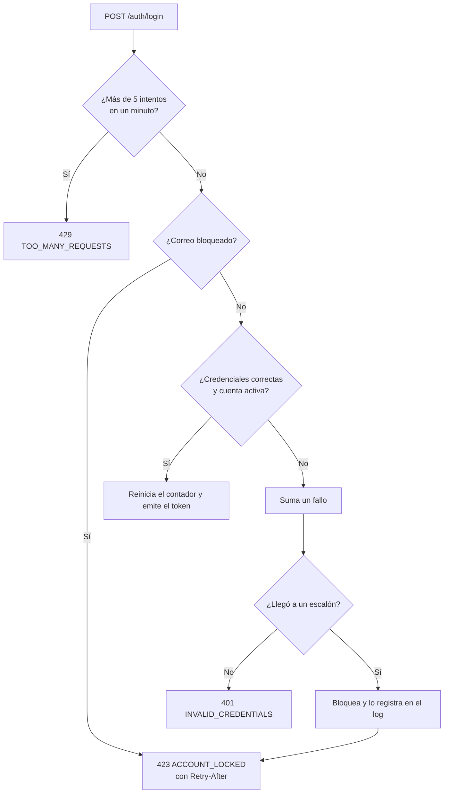

# Módulo Auth

Se encarga de comprobar quién es la persona y de mantener su sesión. Los permisos de cada acción los resuelve cada módulo con sus Policies; Auth solo entrega la lista de permisos del usuario para que el front arme el menú.

## Endpoints

| Método | Ruta | Sesión | Límite | Respuesta |
|---|---|---|---|---|
| `POST` | `/api/v1/auth/login` | No | 5 por minuto (correo + IP) | Token, vencimiento y usuario |
| `POST` | `/api/v1/auth/logout` | Sí | General | `204` y el token queda revocado |
| `GET` | `/api/v1/auth/me` | Sí | General | Usuario con roles y permisos |

Todas las rutas de la API tienen además el límite general de 120 peticiones por minuto, por usuario o por IP.

```json
POST /api/v1/auth/login
{ "email": "agente1@trazo.test", "password": "••••••••••••" }

200 OK
{
  "data": {
    "token": "12|trazo_…",
    "token_type": "Bearer",
    "expires_at": "2026-10-22T20:54:28+00:00",
    "user": {
      "id": "01m5fr6tp5p0cbwjtjwdsst5n0",
      "name": "Laura Gómez",
      "email": "agente1@trazo.test",
      "roles": [{ "code": "agent", "name": "Agente" }],
      "permissions": ["dashboard.view.own", "incidents.create", "…"]
    }
  }
}
```

## Flujo del login



## Errores

| Código | Estado | Cuándo | Parámetros |
|---|---|---|---|
| `INVALID_CREDENTIALS` | 401 | Contraseña incorrecta, correo inexistente o cuenta inactiva | — |
| `ACCOUNT_LOCKED` | 423 | Demasiados fallos seguidos con ese correo | `retry_after` (segundos), también en la cabecera `Retry-After` |
| `TOO_MANY_REQUESTS` | 429 | Más de 5 intentos por minuto con el mismo correo desde la misma IP | Cabecera `Retry-After` |
| `UNAUTHENTICATED` | 401 | Sin token, o con un token revocado, vencido o inactivo | — |

## Reglas de seguridad

### No revelar qué cuentas existen
- El mismo `INVALID_CREDENTIALS` sirve para la contraseña incorrecta, el correo que no existe y la cuenta inactiva. Las tres respuestas son idénticas, salvo el `trace_id`.
- **Mismo tiempo de respuesta.** Si el correo no existe, la contraseña se verifica igual contra un hash de relleno con los mismos parámetros de Argon2id. Así, el tiempo de respuesta no delata nada.
- **El bloqueo se aplica por correo, exista o no la cuenta.** Si solo se bloquearan las cuentas reales, "cuenta bloqueada" confirmaría que ese correo existe.

### Bloqueo progresivo
| Fallos seguidos | Espera |
|---|---|
| 5 | 1 minuto |
| 10 | 5 minutos |
| 15 | 15 minutos |
| 20 o más | 1 hora en cada fallo |

- Mientras dure el bloqueo, ni siquiera la contraseña correcta permite ingresar.
- Un ingreso correcto reinicia el contador. Si no, el contador vence 24 horas después del primer fallo.
- **Dónde vive:** en Redis, con la huella SHA-256 del correo como clave, nunca el correo en claro.
- **Ajustes:** los escalones son datos en `config/trazo.php`.
- **Registro en el log:** cada bloqueo se registra como advertencia, con la huella, la IP y la cantidad de fallos. Los fallos aislados no se registran, para no llenar el log de ruido.

### Sesión
| Regla | Valor | Dónde se cambia |
|---|---|---|
| Duración máxima | 8 horas desde el ingreso | `SESSION_MAX_MINUTES` |
| Inactividad | Se cierra tras 1 hora sin peticiones | `SESSION_IDLE_MINUTES` |
| Cuenta desactivada | Sus sesiones abiertas dejan de valer en la siguiente petición | — |
| Cierre de sesión | El token se borra en el servidor | — |

- **Tokens:**
  - Se guarda solo el hash SHA-256 del token. El valor en claro se entrega una única vez, al iniciar sesión.
  - Los tokens llevan el prefijo `trazo_`, para que los escáneres de secretos los reconozcan si alguno se filtra.
  - Cada día, el scheduler borra los tokens vencidos hace más de un día.
- **Contraseñas:** al ingresar, si cambiaron los parámetros de Argon2id, la contraseña se vuelve a calcular con los nuevos. Las reglas de longitud mínima y contraseñas filtradas se aplican al crearlas o cambiarlas, no al ingresar.
- **MFA:** el login emite hoy un token con acceso completo. Cuando llegue el MFA, el token quedará restringido hasta que se verifique el código, sin cambiar este flujo.

## Capas

| Capa | Pieza | Qué hace |
|---|---|---|
| Domain | `LockoutPolicy` | Escalones del bloqueo (lógica pura) |
| Domain | `LoginAttemptStore` | Contrato para llevar fallos y bloqueos |
| Domain | `InvalidCredentialsException`, `AccountLockedException` | Errores del negocio |
| Application | `LoginUser`, `LogoutUser` | Casos de uso |
| Application | `CredentialVerifier`, `SessionTokens`, `SessionUserReader` | Puertos que implementa la infraestructura |
| Infrastructure | `EloquentCredentialVerifier`, `SanctumSessionTokens`, `CacheLoginAttemptStore`, `EloquentSessionUserReader` | Implementaciones con Eloquent, Sanctum y Redis |
| Infrastructure | `AuthServiceProvider` | Conexión de los puertos, límite del login, inactividad y morph map |
| Http | `AuthController`, `LoginRequest`, `SessionUserResource` | Endpoints, validación de entrada y forma de la respuesta |

## Dónde está en el código

- [`backend/app/Modules/Auth/`](../../backend/app/Modules/Auth/)
- [`backend/config/sanctum.php`](../../backend/config/sanctum.php) y [`backend/config/trazo.php`](../../backend/config/trazo.php)
- [`backend/routes/console.php`](../../backend/routes/console.php): limpieza diaria de tokens.
- Pruebas: [`tests/Feature/Auth/`](../../backend/tests/Feature/Auth/) y [`tests/Unit/Auth/`](../../backend/tests/Unit/Auth/)
- Tabla: [personal_access_tokens](../base-de-datos/diccionario/personal-access-tokens.md)
- Decisiones: [ADR-0015](../decisiones/0015-autenticacion-sanctum.md), [ADR-0016](../decisiones/0016-contrasenas.md) y [ADR-0042](../decisiones/0042-sesion-y-bloqueo.md)
