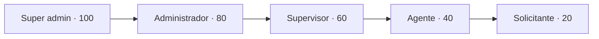

# Módulo Users

Se encarga de administrar a las personas que usan Trazo: crearlas, corregir sus datos, darles un rol, concederles o quitarles permisos, activarlas o desactivarlas, y restablecer su MFA o su acceso. También es el dueño de los **permisos efectivos**, que consultan todos los módulos.

## Endpoints

Todos exigen sesión. Quien no tiene `users.view` recibe `403` en cualquiera de ellos.

| Método | Ruta | Permiso | Código de quien administra | Respuesta |
|---|---|---|---|---|
| `GET` | `/api/v1/users` | `users.view` | — | Página de personas (`search`, `sort`, `filter[role]`, `filter[status]`, `filter[mfa]`) |
| `POST` | `/api/v1/users` | `users.create` | Si el rol trae permisos sensibles | `201` con la ficha; admite `Idempotency-Key` |
| `GET` | `/api/v1/users/{id}` | `users.view` | — | Ficha con permisos, incidentes pendientes asignados y `actions` |
| `PATCH` | `/api/v1/users/{id}` | `users.update` | — | Ficha; si cambió el correo, avisa a la dirección anterior |
| `PUT` | `/api/v1/users/{id}/roles` | `users.roles.assign` | Si el rol anterior o el nuevo traen permisos sensibles | Ficha |
| `PUT` | `/api/v1/users/{id}/permissions` | `users.permissions.grant` | Si cambia un permiso sensible | Ficha. Recibe los permisos que debe **tener**; el back calcula las excepciones |
| `POST` | `/api/v1/users/{id}/activate` y `/deactivate` | `users.activate` | — | Ficha; desactivar cierra sus sesiones al instante |
| `DELETE` | `/api/v1/users/{id}/mfa` | `users.mfa.reset` | Siempre | Ficha |
| `POST` | `/api/v1/users/{id}/access-reset` | `users.access.reset` | Siempre | Ficha |
| `GET` | `/api/v1/roles` | `users.view` | — | Roles con nivel, permisos y si quien consulta los puede dar (`assignable`) |
| `GET` | `/api/v1/permissions` | `users.view` | — | Permisos con su módulo, si son sensibles y si quien consulta los puede conceder (`grantable`) |

Los permisos sensibles son los de los módulos `users`, `roles` y `system`. El código viaja en el campo `code` del cuerpo.

```json
GET /api/v1/users/01m5nzqhhgqs8myzj3rq3smqex

{
  "data": {
    "id": "01m5nzqhhgqs8myzj3rq3smqex",
    "name": "Laura Gómez",
    "email": "agente1@trazo.test",
    "is_active": true,
    "role": { "code": "agent", "name": "Agente", "level": 40 },
    "mfa_enabled": true,
    "last_login_at": "2026-10-24T15:46:00+00:00",
    "created_at": "2026-10-23T22:37:00+00:00",
    "permissions": {
      "effective": ["audit.view", "dashboard.view.own", "incidents.create", "…"],
      "role": ["dashboard.view.own", "incidents.create", "incidents.take", "…"],
      "granted": ["audit.view"],
      "denied": ["incidents.take"]
    },
    "pending_assigned_incidents": 7,
    "is_self": false,
    "actions": {
      "update": true, "activate": false, "deactivate": true, "assign_role": true,
      "grant_permissions": true, "reset_mfa": false, "reset_access": false
    }
  }
}
```

## Jerarquía



- **Solo se administra hacia abajo.** Quien administra actúa sobre personas con un nivel menor que el suyo, y solo da roles por debajo de su nivel.
- **La cima (Super admin) administra a todos**, incluso a otro Super admin (por ejemplo, para restablecer su MFA si perdió el teléfono).
- **Nadie se cambia a sí mismo** el rol, los permisos, el estado ni el acceso. Sus propios datos (nombre y correo) sí los corrige.
- **Siempre queda un Super admin activo.** Desactivar o bajar de rol a uno bloquea antes a los Super admin activos en la misma transacción. Si quedaría ninguno, responde `LAST_SUPER_ADMIN`.

## Permisos por persona

- **Efectivos** = los del rol + los concedidos − los quitados. Si un permiso está a la vez concedido y quitado, gana el quitado.
- **Cómo se cambian:** el front envía la lista de permisos que la persona debe tener. `PermissionChange` (dominio) calcula las excepciones respecto de su rol y qué gana o pierde.
- **Nadie concede lo que no tiene**, salvo la cima. Quitar sí se puede.
- **El Super admin no lleva excepciones:** su rol ya trae todo.
- **Al cambiar de rol** se quitan las excepciones que el rol nuevo vuelve innecesarias (un concedido que el rol ya trae, o un quitado que el rol ya no trae).
- **Dónde se aplica la regla:** `UserPermissions` es la consulta única para la sesión, `/auth/me` y las reglas de cada módulo. `PermissionSql` es la misma regla como filtro SQL, para elegir personas por permiso (por ejemplo, el selector de "asignar a"). Una prueba compara las dos con cada permiso y cada persona.

## Cuenta nueva y acceso restablecido

- **Crear una cuenta:** nace con una contraseña aleatoria de 64 caracteres que nadie conoce. Le llega un correo de bienvenida con su rol y los pasos para crear su contraseña en `/recuperar`, que es el mismo flujo de recuperación con código. El correo no lleva contraseñas ni códigos.
- **Restablecer el acceso:** cambia la contraseña por una aleatoria, cierra sus sesiones y le avisa cómo crear una nueva.
- **Restablecer el MFA:** quita su clave y sus códigos de recuperación y cierra sus sesiones. En el siguiente ingreso lo configura de nuevo.

## Reautenticación

- **Cómo se confirma:** con el código actual de la aplicación de quien administra. El código no se puede repetir (`last_used_step`, igual que en el ingreso).
- **Respuestas posibles:**
  - Sin código: `REAUTHENTICATION_REQUIRED`.
  - Código incorrecto: `MFA_CODE_INVALID` con `attempts_left`.
  - Quien administra no tiene MFA: `REAUTHENTICATION_UNAVAILABLE`.
  - Cinco códigos incorrectos en un minuto: `423 REAUTHENTICATION_LOCKED` con `Retry-After`.
- **Orden de las revisiones:** primero el permiso y la jerarquía, después el código. Así nadie gasta intentos en algo que de todos modos no puede hacer.

## Registro y avisos

- **Registro en `admin_actions`:** cada cambio queda con quien lo hizo, el tipo, la persona afectada, los valores anteriores y nuevos, la IP y el navegador.
- **Avisos por correo** (en la cola, texto plano, `Mail/AccountNotice` y `Mail/AccountWelcome`): bienvenida, rol cambiado, permisos cambiados, cuenta activada o desactivada, MFA restablecido, acceso restablecido y correo cambiado. Este último va a la dirección anterior.
- **No revelar qué correos existen:** las peticiones de la administración revisan el permiso **antes** de validar (`ChecksPermission`), así nadie sin permiso averigua si un correo existe por el error de "en uso".

## Errores

| Código | Estado | Cuándo |
|---|---|---|
| `FORBIDDEN_ACTION` | 403 | Le falta el permiso de la acción |
| `USER_SELF_MANAGEMENT` | 403 | Quiso cambiarse a sí mismo el rol, los permisos, el estado o el acceso |
| `USER_OUTRANKED` | 403 | La persona está en su mismo nivel o por encima |
| `USER_ROOT_FULL_ACCESS` | 409 | Quiso dar o quitar permisos a un Super admin |
| `USER_ALREADY_ACTIVE` / `USER_ALREADY_INACTIVE` | 409 | La cuenta ya estaba en ese estado |
| `USER_MFA_NOT_ENABLED` | 409 | Restablecer un MFA que no está activo |
| `LAST_SUPER_ADMIN` | 409 | El cambio dejaría el sistema sin Super admin activo |
| `ROLE_NOT_ASSIGNABLE` | 422 | El rol está en su nivel o por encima |
| `PERMISSION_NOT_GRANTABLE` | 422 | Quiso conceder permisos que no tiene (`permissions`) |
| `REAUTHENTICATION_REQUIRED` / `REAUTHENTICATION_UNAVAILABLE` | 422 | Falta el código, o quien administra no tiene MFA |
| `REAUTHENTICATION_LOCKED` | 423 | Cinco códigos incorrectos en un minuto (`Retry-After`) |
| `ALREADY_TAKEN` (campo `email`) | 422 | El correo ya es de otra cuenta |

## Capas

| Capa | Pieza | Qué hace |
|---|---|---|
| Domain | `UserAccess`, `UserAction`, `UserDenial` | Quién puede administrar a quién y por qué no (lógica pura) |
| Domain | `Administrator`, `ManagedUser`, `RoleLevel` | Quien administra (nivel y permisos), la persona administrada y el tope de la jerarquía |
| Domain | `PermissionChange`, `SensitivePermissions`, `UserSort`, `Exceptions/UserExceptions` | Excepciones de permisos, permisos sensibles, orden del listado y errores |
| Application | `ListUsers`, `CreateUser`, `UpdateUser`, `ChangeUserStatus`, `ChangeUserRole`, `ChangeUserPermissions`, `ResetUserAccess` | Casos de uso |
| Application | `UserGate`, `Administrators`, `UserProfiles`, `RootGuard` | Cargar y autorizar, armar a quien administra, la ficha y la protección del último Super admin |
| Application | `UserRepository`, `UserListQuery`, `RoleCatalog`, `EffectivePermissions`, `AccountSecurity`, `AdminLog`, `AccountNotifier` | Puertos |
| Infrastructure | `EloquentUserRepository`, `EloquentUserList`, `UserMapper`, `DatabaseRoleCatalog`, `DatabaseAdminLog` | Personas, listado, roles y registro |
| Infrastructure | `UserPermissions`, `PermissionSql` | Permisos efectivos por persona y como filtro SQL |
| Infrastructure | `AuthAccountSecurity` | Puente con el módulo Auth: cerrar sesiones, quitar el MFA y reautenticar |
| Infrastructure | `MailAccountNotifier`, `Mail/AccountNotice`, `Mail/AccountWelcome` | Avisos por correo |
| Http | `UserController`, `UserAccessController`, `AccessCatalogController`, `UserResource`, `RequestAdmin` | Endpoints y forma de la respuesta |
| Http | `Requests/ListUsersRequest`, `UserRequest`, `UserAccessRequest`, `ChecksPermission` | Validación, con el permiso revisado antes |

## Dónde está en el código

- [`backend/app/Modules/Users/`](../../backend/app/Modules/Users/)
- Correos: [`account-notice.blade.php`](../../backend/resources/views/mail/account-notice.blade.php) y [`account-welcome.blade.php`](../../backend/resources/views/mail/account-welcome.blade.php)
- Pruebas: [`tests/Feature/Users/`](../../backend/tests/Feature/Users/) y [`tests/Unit/Users/`](../../backend/tests/Unit/Users/)
- Tablas: [roles y permisos](../base-de-datos/diccionario/roles-y-permisos.md), [users](../base-de-datos/diccionario/users.md) y [admin_actions](../base-de-datos/diccionario/admin-actions.md)
- Decisiones: [ADR-0021](../decisiones/0021-permisos-granulares.md), [ADR-0053](../decisiones/0053-administracion-de-usuarios.md) y [ADR-0054](../decisiones/0054-matriz-de-permisos-no-destructiva.md)
