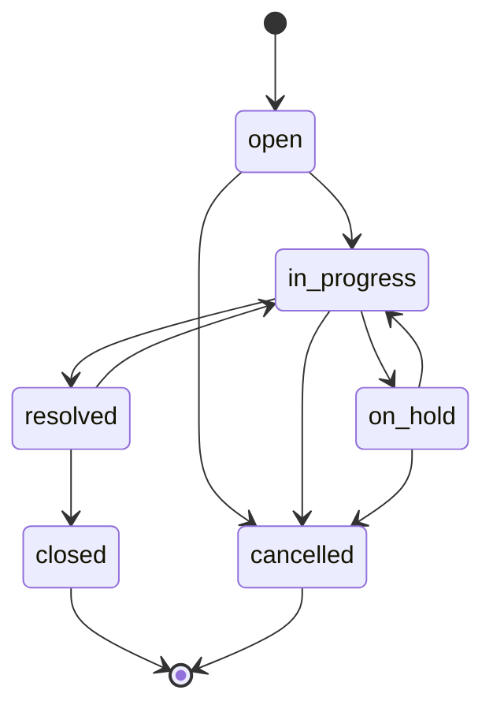

# Catálogos

Los catálogos son datos, no código: agregar un estado o cambiar el flujo es insertar filas. **Nunca se borran** (se desactivan con `is_active`) y se referencian siempre por su `code`. Los colores no se guardan aquí: el frontend asocia cada `code` a un token de diseño.

## priorities

| Columna | Tipo | Restricciones | Descripción |
|---|---|---|---|
| `id` | TINYINT UNSIGNED | PK | |
| `code` | VARCHAR(30) | UNIQUE, NOT NULL | |
| `name` | VARCHAR(50) | NOT NULL | |
| `level` | TINYINT UNSIGNED | UNIQUE, CHECK ≥ 1 | Orden de gravedad: ordenar por prioridad es ordenar por este valor |
| `default_resolution_minutes` | INT UNSIGNED | NOT NULL, CHECK > 0 | Base para sugerir la fecha de vencimiento |
| `is_active` | BOOLEAN | NOT NULL | |

| code | Nombre | level | Resolución sugerida |
|---|---|---|---|
| `low` | Baja | 1 | 5 días |
| `medium` | Media | 2 | 3 días |
| `high` | Alta | 3 | 1 día |
| `critical` | Crítica | 4 | 4 horas |

## statuses

| Columna | Tipo | Descripción |
|---|---|---|
| `id` | TINYINT UNSIGNED, PK | |
| `code` | VARCHAR(30), UNIQUE | |
| `name` | VARCHAR(50) | |
| `sort_order` | TINYINT UNSIGNED | Orden de presentación |
| `is_initial` | BOOLEAN | Estado con el que nace un incidente |
| `is_pending` | BOOLEAN | Trabajo pendiente: cuenta para "vencido" |
| `is_final` | BOOLEAN | Fin del ciclo de vida |
| `requires_note` | BOOLEAN | Llegar a este estado exige una nota ([ADR-0071](../../decisiones/0071-nota-de-estado-y-reapertura.md)) |
| `is_active` | BOOLEAN | |

| code | Nombre | Inicial | Pendiente | Final | Pide nota |
|---|---|:-:|:-:|:-:|:-:|
| `open` | Abierto | ✓ | ✓ | | |
| `in_progress` | En progreso | | ✓ | | |
| `on_hold` | En espera | | ✓ | | |
| `resolved` | Resuelto | | | | ✓ |
| `closed` | Cerrado | | | ✓ | |
| `cancelled` | Cancelado | | | ✓ | ✓ |

Las banderas describen el comportamiento sin depender del nombre del estado: "vencido" se calcula como `due_date` pasada **y** estado con `is_pending`.

## status_transitions

| Columna | Referencia | ON DELETE |
|---|---|---|
| `from_status_id` | `statuses.id` | RESTRICT |
| `to_status_id` | `statuses.id` | RESTRICT |

PK `(from_status_id, to_status_id)`, índice en `to_status_id` y CHECK que impide la transición de un estado hacia sí mismo.

Cerrado y Cancelado no tienen transiciones de salida. Se reabren por un camino aparte, con solicitud y aprobación ([incident_reopen_requests](incident-reopen-requests.md)).

## activity_types

| code | Nombre |
|---|---|
| `created` | Creado |
| `updated` | Editado |
| `status_changed` | Cambio de estado |
| `assigned` | Asignado |
| `unassigned` | Sin asignar |
| `deleted` | Eliminado |
| `restored` | Restaurado |
| `reopen_requested` | Reapertura solicitada |
| `reopen_rejected` | Reapertura rechazada |
| `reopened` | Reabierto |

## Dónde está en el código

- Migraciones: [`000006`](../../../backend/database/migrations/2026_11_01_000006_create_priorities_table.php) a [`000009`](../../../backend/database/migrations/2026_11_01_000009_create_activity_types_table.php); `requires_note` en [`000035`](../../../backend/database/migrations/2026_11_01_000035_add_requires_note_to_statuses.php)
- Modelos: [`Incidents/Infrastructure/Models/`](../../../backend/app/Modules/Incidents/Infrastructure/Models/)
- Datos: [`IncidentCatalogSeeder.php`](../../../backend/database/seeders/IncidentCatalogSeeder.php)
- Decisión: [ADR-0008](../../decisiones/0008-catalogos.md)
