# Modelo de datos

```mermaid
erDiagram
  users ||--o{ user_role : tiene
  roles ||--o{ user_role : asignado
  roles ||--o{ role_permission : agrupa
  permissions ||--o{ role_permission : concedido
  users ||--o{ incidents : "crea (created_by)"
  users |o--o{ incidents : "atiende (assigned_to)"
  priorities ||--o{ incidents : clasifica
  statuses ||--o{ incidents : "estado actual"
  statuses ||--o{ status_transitions : desde
  statuses ||--o{ status_transitions : hacia
  incidents ||--o{ incident_activities : historial
  users ||--o{ incident_activities : realiza
  activity_types ||--o{ incident_activities : tipo
  permissions |o--o{ dashboard_widgets : "exige"
  users ||--o{ user_dashboard_widgets : "diseño"
  dashboard_widgets ||--o{ user_dashboard_widgets : "lugar"
  roles ||--o| mfa_policies : "exige MFA"
  users ||--o| user_mfa_factors : "segundo factor"
  users ||--o{ user_recovery_codes : "recuperación"
  users ||--o{ password_reset_codes : "recupera la contraseña"
  users ||--o{ user_permissions : "excepciones"
  permissions ||--o{ user_permissions : "concedido o quitado"
  users ||--o{ admin_actions : "administra"
  admin_action_types ||--o{ admin_actions : tipo
  system_event_types ||--o{ system_events : tipo
  users |o--o{ system_events : "cambia su estado"
```

Las tablas de las funcionalidades adicionales (MFA, recuperación de contraseña, logs del sistema, dashboard personalizable y tokens de sesión) se agregan con migraciones nuevas en la fase de cada funcionalidad, sin modificar las existentes.

## Política de claves foráneas

Toda referencia es una clave foránea real; no hay relaciones polimórficas. La acción ante un borrado se elige según el valor histórico del dato:

| Relación | Acción | Por qué |
|---|---|---|
| `incidents.created_by`, `incidents.assigned_to` → `users` | RESTRICT | Nunca se pierde quién reportó o atendió algo. Los usuarios se desactivan, no se borran. |
| `incident_activities` → `incidents`, `users`, `activity_types` | RESTRICT | El historial es inmutable |
| `incidents` → `priorities`, `statuses` | RESTRICT | Un catálogo en uso no se borra; se desactiva |
| `status_transitions` → `statuses` | RESTRICT | Igual que el anterior |
| `user_role.user_id` → `users` | CASCADE | Solo aplica a un usuario sin historial (si tiene historial, el borrado ya está bloqueado) |
| `role_permission.role_id` → `roles` | CASCADE | Sin el rol, sus asignaciones no significan nada |
| `user_role.role_id`, `role_permission.permission_id` | RESTRICT | No se borra un rol o permiso en uso |
| `user_permissions.user_id` → `users` | CASCADE | La excepción es parte de la cuenta |
| `user_permissions.permission_id`, `user_permissions.granted_by` | RESTRICT | No se borra un permiso en uso ni a quien dio la excepción |
| `admin_actions` → `users`, `admin_action_types` | RESTRICT | El registro de la administración es inmutable |
| `system_events` → `system_event_types`, `system_events.status_changed_by` → `users` | RESTRICT | Un tipo en uso no se borra; los usuarios se desactivan, no se borran |
| `admin_actions.target_role_id` → `roles` | SET NULL | Un rol creado se puede eliminar; su historial queda sin enlace, con el código y el nombre en el detalle |
| `mfa_policies.role_id` → `roles` | CASCADE | La política es parte del rol |

Las claves foráneas usan siempre el mismo tipo que la clave a la que apuntan (`BIGINT`, `SMALLINT` o `TINYINT` sin signo).

## Criterios generales

- **Identificadores:** `BIGINT` interno para los JOIN y `ulid` público (único e inmutable) en `users` e `incidents`. Los catálogos se identifican por `code`.
- **Restricciones CHECK** donde la regla es de los datos: nivel de prioridad positivo, transición entre estados distintos, versión de bloqueo mayor o igual a 1.
- **Nombres:** tablas en plural y `snake_case`; claves foráneas `<entidad>_id` (o el rol que cumplen, como `created_by`).
- **Fechas:** en UTC. `utf8mb4_0900_ai_ci` hace que las búsquedas no distingan tildes ni mayúsculas.
- **Limpieza en origen:** correos en minúsculas y sin espacios; `NOT NULL` en todo lo obligatorio.

## Diccionario

| Tabla | Página |
|---|---|
| `users` | [users](diccionario/users.md) |
| `roles`, `permissions`, `role_permission`, `user_role`, `user_permissions` | [Roles y permisos](diccionario/roles-y-permisos.md) |
| `priorities`, `statuses`, `status_transitions`, `activity_types` | [Catálogos](diccionario/catalogos.md) |
| `incidents` | [incidents](diccionario/incidents.md) |
| `incident_activities` | [incident_activities](diccionario/incident-activities.md) |
| `personal_access_tokens` | [personal_access_tokens](diccionario/personal-access-tokens.md) |
| `dashboard_widgets`, `user_dashboard_widgets` | [Dashboard](diccionario/dashboard.md) |
| `mfa_policies`, `user_mfa_factors`, `user_recovery_codes` | [MFA](diccionario/mfa.md) |
| `password_reset_codes` | [password_reset_codes](diccionario/password-reset-codes.md) |
| `admin_action_types`, `admin_actions` | [admin_actions](diccionario/admin-actions.md) |
| `system_event_types`, `system_events` | [system_events](diccionario/system-events.md) |
| `failed_jobs` | Tabla estándar de Laravel para trabajos de cola fallidos |

Datos iniciales: [Seeders](seeders.md).

## Dónde está en el código

- [`backend/database/migrations/`](../../backend/database/migrations/)
- Pruebas de integridad: [`backend/tests/Feature/Database/IntegrityTest.php`](../../backend/tests/Feature/Database/IntegrityTest.php)
- Decisiones: [ADR-0008](../decisiones/0008-catalogos.md), [ADR-0009](../decisiones/0009-sin-polimorficas.md), [ADR-0010](../decisiones/0010-ulid.md) y [ADR-0011](../decisiones/0011-borrado-y-restricciones.md).
