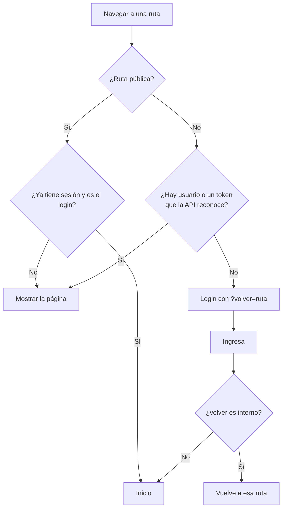

# Módulo de sesión (frontend)

Se encarga del inicio y cierre de sesión en la SPA. **La seguridad real está en la API**: el front solo decide qué mostrar y a dónde llevar a la persona. Las reglas del backend están en [Módulo Auth](../backend/auth.md).

## Flujo

- **Al recargar la página** queda el token en `sessionStorage`, pero no el usuario: la guarda lo pide a `GET /auth/me` antes de mostrar la ruta.
- **Si la API responde `UNAUTHENTICATED`** en cualquier momento (sesión vencida, inactiva o revocada), el cliente HTTP borra el token. La guarda lleva al login con un aviso visible y recuerda la página para volver.
- **Cerrar sesión** revoca el token en la API. Si la API no responde, igual se borra en el navegador, y el token vence solo.

## Pantalla de login

| Vista | Forma |
|---|---|
| Celular | Formulario a ancho completo sobre el fondo de página, sin tarjeta |
| Tablet, portátil y monitor | Tarjeta de 400 px centrada, con el logo centrado |

- **Contenido:**
  - Logo, título "Inicia sesión", correo, contraseña (con botón para mostrarla u ocultarla) y el botón "Ingresar".
  - Los errores van en un aviso siempre visible encima de los campos. Los de cada campo, debajo del campo.
- **Validación visual:** campos vacíos y forma del correo. No reemplaza a la API, solo evita un viaje innecesario.
- **Mientras espera la respuesta,** el botón queda bloqueado y un segundo envío se ignora, para no contar un intento de más.
- **Si el ingreso falla,** la contraseña se borra del campo.
- **Autocompletado:** `username` y `current-password`, para que funcionen los gestores de contraseñas.

### Mensajes

| Código | Mensaje |
|---|---|
| `INVALID_CREDENTIALS` | El correo o la contraseña no son correctos. Revísalos e inténtalo de nuevo. |
| `ACCOUNT_LOCKED` | Por seguridad, pausamos el ingreso con este correo después de varios intentos fallidos. Vuelve a intentarlo en {espera}. |
| `TOO_MANY_REQUESTS` | Hiciste demasiados intentos seguidos. Espera {espera} y vuelve a intentarlo. |
| Llegada por sesión vencida | Tu sesión terminó. Inicia sesión de nuevo para continuar. |

## Redirección segura

Después del login se vuelve a la página indicada en `?volver=`, solo si es una ruta interna (`/algo`). Las direcciones externas (`https://…`) y las que el navegador trata como otro dominio (`//…` o `/\…`) se ignoran y llevan al inicio. Así, un enlace manipulado no puede sacar a nadie de Trazo después de ingresar.

## Menú según permisos

`GET /auth/me` y el login devuelven la lista de permisos. Cada entrada del menú puede declarar el permiso que necesita (`permission` en `navigation.ts`), y el menú muestra solo las permitidas. Ocultar una opción es comodidad, no protección: la API rechaza igual lo que no corresponde.

## Capas

| Capa | Pieza | Qué hace |
|---|---|---|
| domain | `session.ts`, `safeRedirect.ts` | Tipos del usuario, consulta de permisos y redirección segura |
| infrastructure | `authApi.ts` | Llamadas a `/auth` y traducción de la respuesta |
| application | `useSessionStore.ts` | Estado de la sesión (Pinia): ingresar, recuperar, cerrar |
| application | `authGuard.ts` | Guarda de rutas y reacción a la sesión vencida |
| presentation | `LoginPage.vue` | Pantalla de login |
| — | `errors.ts`, `routes.ts` | Mensajes del módulo y ruta pública `/ingresar` |

## Dónde está en el código

- [`frontend/src/modules/auth/`](../../frontend/src/modules/auth/)
- [`frontend/src/app/layout/AppUserMenu.vue`](../../frontend/src/app/layout/AppUserMenu.vue): menú de la persona conectada.
- [`frontend/src/app/navigation.ts`](../../frontend/src/app/navigation.ts): filtrado del menú por permisos.
- [`frontend/src/app/router/index.ts`](../../frontend/src/app/router/index.ts) y [`frontend/src/app/bootstrap.ts`](../../frontend/src/app/bootstrap.ts): guarda de rutas y registro de mensajes.
- Pruebas: archivos `*.spec.ts` dentro del módulo.
- Decisiones: [ADR-0015](../decisiones/0015-autenticacion-sanctum.md) y [ADR-0042](../decisiones/0042-sesion-y-bloqueo.md)
