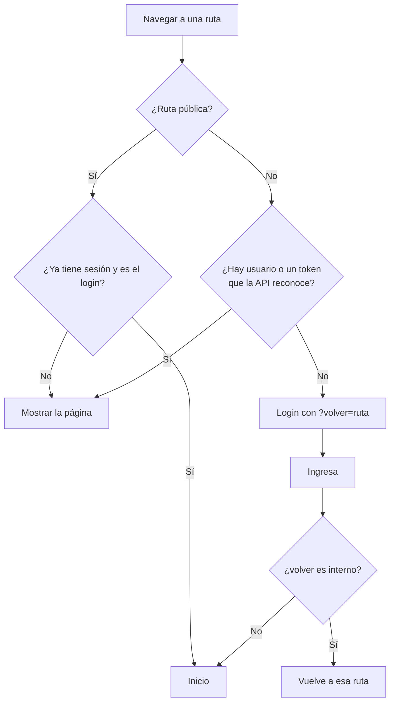

# Módulo de sesión (frontend)

Se encarga del inicio y cierre de sesión en la SPA, de la verificación en dos pasos (MFA) y de Mi cuenta. **La seguridad real está en la API**: el front solo decide qué mostrar y a dónde llevar a la persona. Las reglas del backend están en [Módulo Auth](../backend/auth.md).

## Flujo

- **Al recargar la página** queda el token en `sessionStorage`, pero no el usuario: la guarda lo pide a `GET /auth/me` antes de mostrar la ruta.
- **Si esa consulta falla por otra razón** (sin conexión, mantenimiento o el servidor tardó demasiado), la sesión **no** se borra: solo la API puede decir que ya no vale. La guarda lleva a `/sin-conexion`, que dice qué pasó con el mensaje del catálogo y ofrece "Reintentar", volviendo a la página que se pedía.
- **Si la API responde `UNAUTHENTICATED`** en cualquier momento (sesión vencida, inactiva o revocada), el cliente HTTP borra el token. La guarda lleva al login con un aviso visible y recuerda la página para volver.
- **Cerrar sesión** revoca el token en la API. Si la API no responde, igual se borra en el navegador, y el token vence solo.

## Pantalla de login

| Vista | Forma |
|---|---|
| Celular | Formulario a ancho completo sobre el fondo de página, sin tarjeta |
| Tablet, portátil y monitor | Tarjeta de 400 px centrada, con el logo centrado |

- **Contenido:**
  - Logo, título "Inicia sesión", correo, contraseña (con botón para mostrarla u ocultarla) y el botón "Ingresar".
  - Los errores van en un aviso siempre visible encima de los campos. Los de cada campo, debajo del campo.
- **Validación visual:** campos vacíos y forma del correo. No reemplaza a la API, solo evita un viaje innecesario.
- **Mientras espera la respuesta,** el botón queda bloqueado y un segundo envío se ignora, para no contar un intento de más.
- **Si el ingreso falla,** la contraseña se borra del campo.
- **Autocompletado:** `username` y `current-password`, para que funcionen los gestores de contraseñas.

### Mensajes

| Código | Mensaje |
|---|---|
| `INVALID_CREDENTIALS` | El correo o la contraseña no son correctos. Revísalos e inténtalo de nuevo. |
| `ACCOUNT_LOCKED` | Por seguridad, pausamos el ingreso con este correo después de varios intentos fallidos. Vuelve a intentarlo en {espera}. |
| `TOO_MANY_REQUESTS` | Hiciste demasiados intentos seguidos. Espera {espera} y vuelve a intentarlo. |
| Errores del MFA | Ver [Catálogo de errores](../soporte/catalogo-de-errores.md#verificación-en-dos-pasos) |
| Llegada por sesión vencida | Tu sesión terminó. Inicia sesión de nuevo para continuar. |
| Llegada tras recuperar la contraseña | Tu contraseña cambió y cerramos tus sesiones abiertas. Ingresa con la contraseña nueva. |

Debajo de la contraseña está el enlace "¿Olvidaste tu contraseña?", que lleva a la recuperación.

## Verificación en dos pasos

Después de la contraseña, la API dice qué sigue (`status`):

| Paso | Pantalla |
|---|---|
| `complete` | Entra a la página pedida |
| `setup_suggested` | `/configurar-mfa?sugerido=1`, con "Configurar más tarde" |
| `mfa_verify` | `/ingresar/verificar` |
| `mfa_setup` | `/configurar-mfa`, sin poder posponerlo |

- **El token de un ingreso a medias vive solo en memoria** (`pending` en el store), nunca en `sessionStorage`, y viaja solo en los pedidos del segundo paso. Si se recarga la página, se vuelve a ingresar.
- **`/ingresar/verificar`:** un campo para el código (`AppCodeField`: teclado numérico, autocompletado del teléfono y pegar "123 456" funciona). "¿No tienes tu teléfono? Usa un código de recuperación" cambia a un campo de texto. Un código incorrecto dice cuántos intentos quedan; al quinto, o si pasaron los 5 minutos, solo queda "Volver a ingresar".
- **`/configurar-mfa`:** dentro del mismo marco del login. 1) QR (`AppQrCode`) y la clave en grupos de 4 con "Copiar" (`AppCopyBlock`); qué aplicaciones sirven va en el ícono de información. 2) El primer código y "Activar". 3) Los 8 códigos de recuperación (`RecoveryCodesPanel`) con "Copiar todos" y "Descargar .txt" (se arma en el navegador), y "Continuar" solo después de marcar "Ya guardé mis códigos". Llega de tres formas: obligatoria (con "Volver a ingresar"), sugerida (con "Configurar más tarde") o desde Mi cuenta (con "Cancelar").

## Recuperar la contraseña

Tres pantallas dentro del mismo marco del login (`AuthPanel`):

| Ruta | Qué pide | A dónde sigue |
|---|---|---|
| `/recuperar` | El correo | Siempre a `/recuperar/codigo`, exista o no la cuenta (la API no lo revela) |
| `/recuperar/codigo` | El código de 6 dígitos del correo (`AppCodeField`) | `/recuperar/nueva`. "Enviar otro código" se habilita tras una cuenta regresiva de 60 segundos |
| `/recuperar/nueva` | La contraseña nueva y su confirmación; si la cuenta tiene MFA, el código de la aplicación o, con un cambio, un código de recuperación | Al login, con el aviso de contraseña cambiada |

- **Nada queda guardado en el navegador:** el correo, el pase y si hace falta el segundo factor viven solo en memoria (`useRecoveryStore`). Si se recarga a mitad de camino, las pantallas vuelven a `/recuperar`.
- **Si el pase venció** (`PASSWORD_RESET_EXPIRED`), el aviso ofrece pedir un código nuevo.
- **Requisitos a la vista:** `NewPasswordFields` muestra una lista que se marca mientras se escribe: el largo (12 a 128) y que las dos coincidan. Que no esté filtrada solo lo puede decir la API; si lo está, el error aparece debajo del campo.

## Mi cuenta

`/mi-cuenta`, desde el menú de la persona. Una columna en celular y tablet; dos en portátil y monitor.

- **Tus datos:** nombre, correo y rol.
- **Contraseña:** "Cambiar contraseña" abre un diálogo (`ChangePasswordDialog`) con la actual, la nueva y su confirmación. Una contraseña actual equivocada o una nueva igual a la actual se marcan en su campo, sin cerrar el diálogo. Al cambiarla, avisa que se cerraron las demás sesiones; la actual sigue abierta.
- **Verificación en dos pasos:** si está activa, cuántos códigos de recuperación quedan (con un aviso cuando quedan 2 o menos), "Generar códigos nuevos" y, si el rol no la exige, "Desactivar". Las dos acciones piden el código actual en un diálogo (`AppCodeDialog`, compartido) que muestra el error sin cerrarse. Si no está activa, "Configurar".

## Redirección segura

Después del login se vuelve a la página indicada en `?volver=`, solo si es una ruta interna (`/algo`). Las direcciones externas (`https://…`) y las que el navegador trata como otro dominio (`//…` o `/\…`) se ignoran y llevan al inicio. Así, un enlace manipulado no puede sacar a nadie de Trazo después de ingresar.

## Menú según permisos

`GET /auth/me` y el login devuelven la lista de permisos. Cada entrada del menú puede declarar el permiso que necesita (`permission` en `navigation.ts`), y el menú muestra solo las permitidas. Ocultar una opción es comodidad, no protección: la API rechaza igual lo que no corresponde.

## Capas

| Capa | Pieza | Qué hace |
|---|---|---|
| domain | `session.ts`, `safeRedirect.ts` | Tipos del usuario (con su estado del MFA), pasos del ingreso, consulta de permisos y redirección segura |
| domain | `password.ts` | Largo permitido y requisitos que se muestran mientras se escribe |
| application | `useRecoveryStore.ts` | Estado de la recuperación en memoria: pedir el código, verificarlo y guardar la contraseña |
| infrastructure | `authApi.ts` | Llamadas a `/auth` y traducción de la respuesta |
| application | `useSessionStore.ts` | Estado de la sesión (Pinia): ingresar, ingreso a medias, verificar y configurar el MFA, regenerar códigos, desactivar, recuperar, cerrar |
| application | `authGuard.ts` | Guarda de rutas y reacción a la sesión vencida |
| presentation | `LoginPage.vue` | Pantalla de login |
| presentation | `ConnectionErrorPage.vue` | Aviso de sin conexión con "Reintentar" |
| presentation | `AuthPanel.vue` | Marco común de las pantallas sin sesión: logo, título y tarjeta centrada desde tablet |
| presentation | `mfa/MfaVerifyPage`, `MfaSetupPage`, `RecoveryCodesPanel` | Segundo paso del ingreso, configuración del MFA y códigos de recuperación |
| presentation | `password/ForgotPasswordPage`, `ResetCodePage`, `NewPasswordPage`, `NewPasswordFields` | Las tres pantallas de la recuperación y los campos de contraseña nueva con sus requisitos |
| presentation | `account/AccountPage`, `ChangePasswordDialog` | Mi cuenta y el diálogo del cambio de contraseña (sobre `AppFormDialog`); el código actual lo pide `AppCodeDialog` |
| — | `errors.ts`, `routes.ts` | Mensajes del módulo; rutas públicas `/ingresar`, `/ingresar/verificar`, `/configurar-mfa`, `/recuperar`, `/recuperar/codigo`, `/recuperar/nueva` y `/sin-conexion`, y `/mi-cuenta` dentro del layout |

Los diálogos envuelven su formulario en un `div`: Quasar solo deja pasar los clics al primer `div` dentro de `QDialog`, y con un `form` en la raíz los clics caían al fondo y cerraban el diálogo.

## Dónde está en el código

- [`frontend/src/modules/auth/`](../../frontend/src/modules/auth/)
- [`frontend/src/app/layout/AppUserMenu.vue`](../../frontend/src/app/layout/AppUserMenu.vue): menú de la persona conectada.
- [`frontend/src/app/navigation.ts`](../../frontend/src/app/navigation.ts): filtrado del menú por permisos.
- [`frontend/src/app/router/index.ts`](../../frontend/src/app/router/index.ts) y [`frontend/src/app/bootstrap.ts`](../../frontend/src/app/bootstrap.ts): guarda de rutas y registro de mensajes.
- Pruebas: archivos `*.spec.ts` dentro del módulo.
- Decisiones: [ADR-0015](../decisiones/0015-autenticacion-sanctum.md), [ADR-0042](../decisiones/0042-sesion-y-bloqueo.md), [ADR-0049](../decisiones/0049-sesion-sin-conexion.md), [ADR-0051](../decisiones/0051-mfa-en-la-practica.md) y [ADR-0052](../decisiones/0052-recuperacion-y-cambio-de-contrasena.md)
