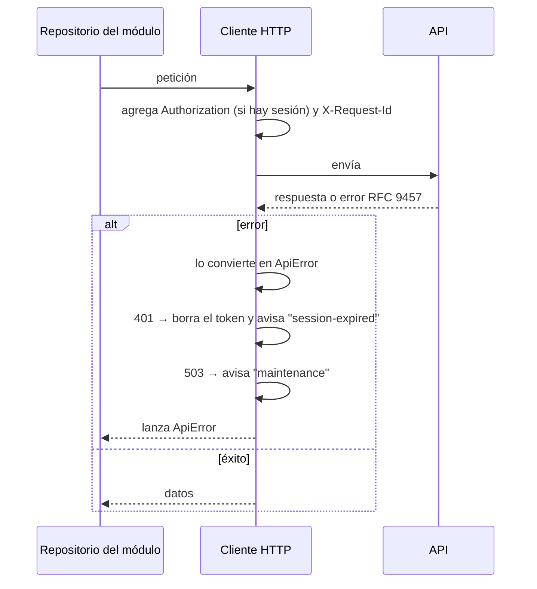

# Cliente HTTP y errores

Toda la comunicación con la API pasa por **un único cliente** (`shared/http`). Ninguna vista lo usa directamente: cada módulo lo envuelve en sus repositorios.

## Qué hace en cada petición

| Aspecto | Comportamiento |
|---|---|
| Base | `/api/v1`, mismo origen que la SPA (configurable con `VITE_API_BASE_URL`) |
| Token | `Authorization: Bearer …`, guardado en memoria y en `sessionStorage`; nunca en `localStorage` |
| Identificador de petición | `X-Request-Id` generado en el navegador, para cruzar un error con los logs |
| Tiempo de espera | 15 segundos |
| Reintentos | Solo **lecturas** (`GET`) ante fallas de red, 502 o 504; hasta 2 reintentos. Una escritura nunca se repite. |

## ApiError

Cualquier falla llega a la app con la misma forma, sin importar si vino de la API, de la red o de un tiempo de espera:

| Campo | Contenido |
|---|---|
| `kind` | `http`, `network`, `timeout` o `canceled` |
| `code` | Código de la API (`VALIDATION_FAILED`…) o del cliente (`NETWORK_ERROR`, `TIMEOUT`, `REQUEST_CANCELED`, `UNKNOWN_ERROR`) |
| `status` | Estado HTTP, si hubo respuesta |
| `params` | Datos para el mensaje |
| `fieldErrors` | Errores por campo |
| `traceId` | Código para soporte |
| `retryAfter` | Segundos de espera en un 429 |

## Catálogo de mensajes

`shared/errors` convierte códigos en texto claro, sin tecnicismos:

- `messageFor(error)`: mensaje general (notificación o banner).
- `fieldMessageFor(fieldError)` / `fieldMessagesFor(error)`: mensaje junto a cada campo del formulario.
- `registerErrorMessages({...})`: cada módulo registra sus códigos de negocio.

Los mensajes de campo no repiten el nombre del campo porque se muestran a su lado. Un código desconocido nunca deja la pantalla en blanco: muestra un mensaje útil con el código de soporte. La lista completa de mensajes está en el [catálogo de errores](../soporte/catalogo-de-errores.md).

## Dónde está en el código

- [`shared/http/client.ts`](../../frontend/src/shared/http/client.ts): cliente e interceptores.
- [`shared/http/apiError.ts`](../../frontend/src/shared/http/apiError.ts): normalización de errores.
- [`shared/http/tokenStore.ts`](../../frontend/src/shared/http/tokenStore.ts) y [`events.ts`](../../frontend/src/shared/http/events.ts).
- [`shared/errors/`](../../frontend/src/shared/errors/): catálogo y mensajes.
- Pruebas: archivos `*.spec.ts` junto a cada uno.
