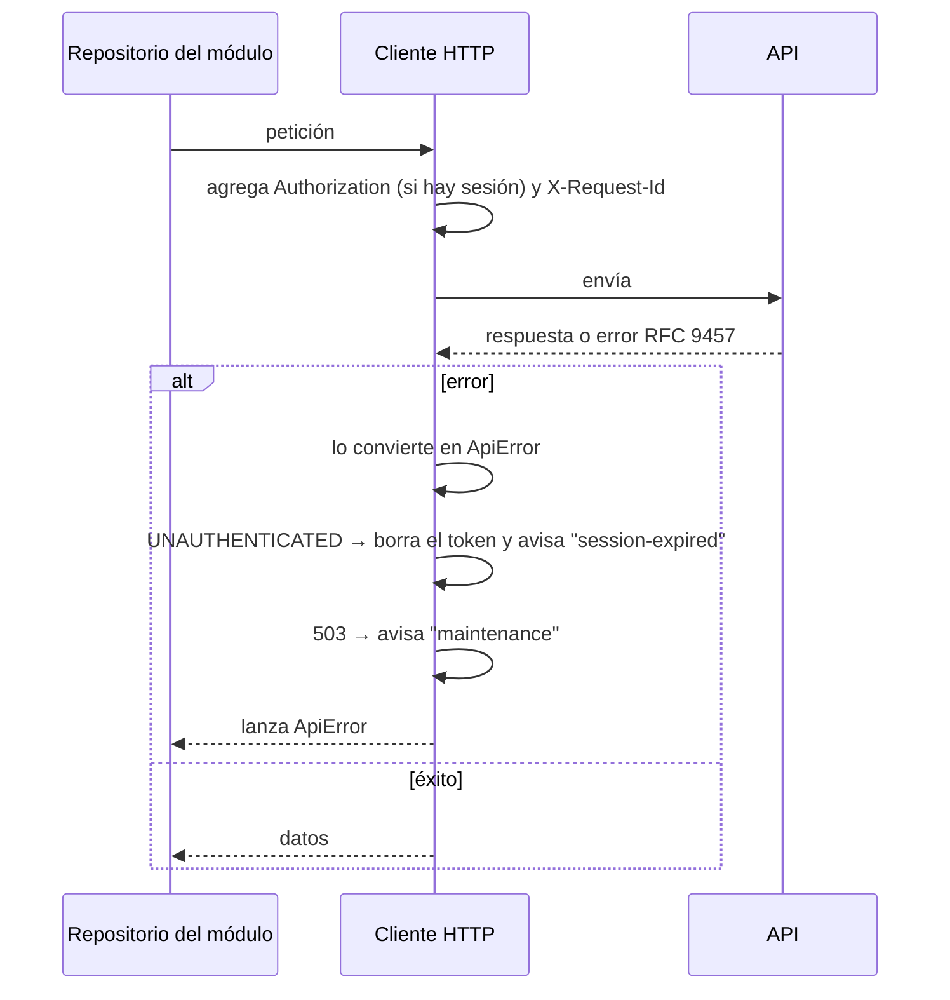

# Cliente HTTP y errores

Toda la comunicación con la API pasa por **un único cliente** (`shared/http`). Ninguna vista lo usa directamente: cada módulo lo envuelve en sus repositorios.

## Qué hace en cada petición

| Aspecto | Comportamiento |
|---|---|
| Base | `/api/v1`, mismo origen que la SPA (configurable con `VITE_API_BASE_URL`) |
| Token | `Authorization: Bearer …`, guardado en memoria y en `sessionStorage`; nunca en `localStorage` |
| Identificador de petición | `X-Request-Id` generado en el navegador, para cruzar un error con los logs |
| Tiempo de espera | 15 segundos |
| Reintentos | Solo **lecturas** (`GET`) ante fallas de red, 502 o 504; hasta 2 reintentos. Una escritura nunca se repite. |

## ApiError

Cualquier falla llega a la app con la misma forma, sin importar si vino de la API, de la red o de un tiempo de espera:

| Campo | Contenido |
|---|---|
| `kind` | `http`, `network`, `timeout` o `canceled` |
| `code` | Código de la API (`VALIDATION_FAILED`…) o del cliente (`NETWORK_ERROR`, `TIMEOUT`, `REQUEST_CANCELED`, `SERVER_UNREACHABLE`, `UNKNOWN_ERROR`) |
| `status` | Estado HTTP, si hubo respuesta |
| `params` | Datos para el mensaje |
| `fieldErrors` | Errores por campo |
| `traceId` | Código para soporte |
| `retryAfter` | Segundos de espera en un 429 o un 423 (cabecera `Retry-After`) |

Si la respuesta no trae el formato de error de la API (por ejemplo, una página HTML del gateway porque la API está caída), el código sale del estado: 502 y 504 dan `SERVER_UNREACHABLE` y 503 da `SERVICE_UNAVAILABLE`. Así la persona ve un mensaje claro en lugar de uno genérico.

## Sesión vencida

Solo el código `UNAUTHENTICATED` cierra la sesión en el navegador. Un 401 con otro código, como `INVALID_CREDENTIALS` en el login, lo maneja la pantalla que hizo la petición. Si no fuera así, una contraseña mal escrita se trataría como una sesión vencida.

## Catálogo de mensajes

`shared/errors` convierte códigos en texto claro, sin tecnicismos:

- `messageFor(error)`: mensaje general (notificación o banner).
- `fieldMessageFor(fieldError)` / `fieldMessagesFor(error)`: mensaje junto a cada campo del formulario.
- `registerErrorMessages({...})`: registra códigos de negocio. Cada módulo los declara en `modules/<módulo>/errors.ts` y el arranque de la app los registra solos.

Las plantillas pueden usar `{traceId}` (código de soporte) y `{wait}`, la espera de `Retry-After` en texto natural ("30 segundos", "5 minutos", "1 hora").

Los mensajes de campo no repiten el nombre del campo porque se muestran a su lado. Un código desconocido nunca deja la pantalla en blanco: muestra un mensaje útil con el código de soporte. La lista completa de mensajes está en el [catálogo de errores](../soporte/catalogo-de-errores.md).

## Listados ligados a la URL

`useRouteList` es la base de todo listado: los criterios salen de la URL, cada cambio la actualiza y eso dispara la consulta. Cancela la consulta anterior si llega otra, descarta respuestas viejas, y cambiar un filtro vuelve a la primera página. Cada módulo le pasa:

- `fromQuery` y `toQuery`: cómo se leen y se escriben sus criterios. Se apoyan en `shared/routing/queryValues.ts`: `queryOne`, `queryList`, `queryPositive`, `queryChoice` y `compactQuery`, que ignoran lo que no reconocen y dejan la URL corta.
- `fetch`: la llamada de su repositorio.
- `ready` (opcional): cuándo todavía no consultar, por ejemplo una búsqueda incompleta.

La usan los listados de incidentes y de usuarios.

## Revisiones visuales compartidas

`shared/validation/email.ts` (`looksLikeEmail`) es la única revisión de la forma de un correo antes de enviarlo: la usan el login, la recuperación de contraseña y la administración. Solo evita un viaje innecesario; la API valida de verdad.

## Dónde está en el código

- [`shared/http/client.ts`](../../frontend/src/shared/http/client.ts): cliente e interceptores.
- [`shared/http/apiError.ts`](../../frontend/src/shared/http/apiError.ts): normalización de errores.
- [`shared/http/tokenStore.ts`](../../frontend/src/shared/http/tokenStore.ts) y [`events.ts`](../../frontend/src/shared/http/events.ts).
- [`shared/errors/`](../../frontend/src/shared/errors/): catálogo, mensajes y `formatWait`.
- [`shared/listing/useRouteList.ts`](../../frontend/src/shared/listing/useRouteList.ts), [`shared/routing/queryValues.ts`](../../frontend/src/shared/routing/queryValues.ts) y [`shared/validation/email.ts`](../../frontend/src/shared/validation/email.ts).
- Pruebas: archivos `*.spec.ts` junto a cada uno.
