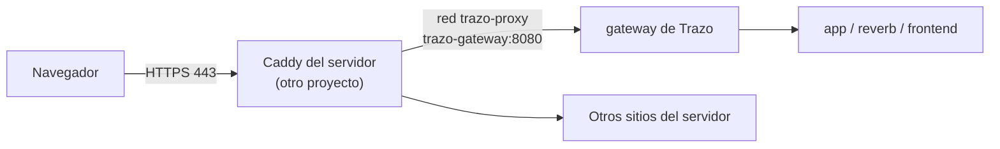

# Despliegue

Trazo corre en un VPS con el mismo compose de siempre más `docker-compose.prod.yml`. En ese servidor ya hay otros proyectos y un **Caddy** que ocupa los puertos 80 y 443 y saca los certificados de Let's Encrypt. Trazo no publica ningún puerto: Caddy le pasa las peticiones de `trazo.daniuh.dev` por una red de Docker compartida, `trazo-proxy`.



## Reglas de convivencia

- Todo lo de Trazo se maneja con `docker compose -p trazo ...`: contenedores, redes y volúmenes llevan el prefijo `trazo`.
- A los otros proyectos no se les reinicia ni recrea nada. Al Caddy solo se le **agrega una red en caliente** y se le **recarga la configuración**, que no corta las conexiones abiertas. Si la configuración nueva tiene un error, Caddy sigue con la anterior.
- Antes de editar el `Caddyfile` se guarda una copia con fecha. Se edita en el mismo archivo (sin reemplazarlo), porque Caddy lo tiene montado y un archivo nuevo no lo vería.
- Si alguien vuelve a crear el contenedor de Caddy desde su proyecto, pierde la red `trazo-proxy` y Trazo deja de responder (los otros sitios siguen bien). Se arregla volviendo a correr `scripts/deploy/deploy.sh`, que lo conecta de nuevo.

## Primer despliegue

1. **Código:** `git clone https://github.com/Daniuh/trazo.git /root/trazo` (rama `main`).
2. **Secretos:** `sh scripts/deploy/new-env.sh trazo.daniuh.dev`. Crea el `.env` con permisos 600 y secretos aleatorios generados en el servidor (llave de la app, MySQL, Redis, Reverb y la llave de los respaldos).
3. **Lo que se escribe a mano en ese `.env`:** el correo de Gmail y su contraseña de aplicación (`MAIL_*`), las cuentas por rol ([cuentas](cuentas.md)) y `TRAZO_PROXY_CONTAINER` con el nombre del contenedor de Caddy.
4. **Guardar fuera del servidor** `APP_KEY` y `BACKUP_ENCRYPTION_KEY`: sin ellas no se pueden abrir los datos cifrados ni los respaldos ([respaldos](respaldos.md)).
5. **Levantar:** `sh scripts/deploy/deploy.sh`. Construye las imágenes, levanta el stack con `--wait`, conecta el Caddy a `trazo-proxy` y muestra el estado.
6. **Caddy:** agregar el bloque del sitio, validar y recargar:

   ```caddyfile
   trazo.daniuh.dev {
       encode zstd gzip
       reverse_proxy trazo-gateway:8080
   }
   ```

   ```bash
   docker exec <caddy> caddy validate --config /etc/caddy/Caddyfile --adapter caddyfile
   docker exec <caddy> caddy reload --config /etc/caddy/Caddyfile --adapter caddyfile
   ```

   Las cabeceras de seguridad (CSP, HSTS y demás) las pone el gateway de Trazo; el bloque de Caddy no agrega ninguna para no duplicarlas.

## Actualizar

```bash
cd /root/trazo
git pull --ff-only
sh scripts/deploy/deploy.sh
```

Las migraciones son solo aditivas y corren solas en `init`. Los datos, las llaves y los respaldos viven en volúmenes y no se tocan.

## Qué cambia en producción

| | Local | Producción |
|---|---|---|
| Archivos | `docker-compose.yml` + `override` | `docker-compose.yml` + `prod` |
| Puerto publicado | 8088 (y 8025 de Mailpit) | Ninguno: entra por `trazo-proxy` |
| Secretos | Valores "solo local" o generados en un volumen | Obligatorios en el `.env`: si falta uno, Compose no arranca |
| Correo | Mailpit | SMTP de Gmail |
| Usuarios de demostración | Sí | No: solo las cuentas por rol del entorno |
| Incidentes de prueba | Sí (600) | Solo con `SEED_INCIDENTS_IN_PRODUCTION=true`, repartidos entre las cuentas por rol ([ADR-0089](../decisiones/0089-incidentes-de-muestra-en-el-sitio-de-evaluacion.md)) |
| IP del visitante | La que llega al gateway | La que pasa Caddy, solo creída si viene de `trazo-proxy` |
| HSTS | No (HTTP) | Sí, porque Caddy avisa que la petición llegó por HTTPS |

La IP real importa porque los límites del login y de la recuperación de contraseña cuentan por IP: sin ella, todas las personas compartirían la IP de Caddy y se bloquearían entre sí.

## Revisar

```bash
docker compose -p trazo -f docker-compose.yml -f docker-compose.prod.yml ps
docker compose -p trazo -f docker-compose.yml -f docker-compose.prod.yml logs --tail=100 app
curl -sI https://trazo.daniuh.dev/up
```

## Dónde está en el código

- [docker-compose.prod.yml](../../docker-compose.prod.yml): secretos obligatorios, gateway sin puerto y red `trazo-proxy`.
- [docker/nginx/real-ip.prod.conf](../../docker/nginx/real-ip.prod.conf): de qué red se acepta `X-Forwarded-For`.
- [scripts/deploy/new-env.sh](../../scripts/deploy/new-env.sh): crea el `.env` con secretos aleatorios.
- [scripts/deploy/deploy.sh](../../scripts/deploy/deploy.sh): construye, levanta y conecta el proxy.
- [ADR-0088](../decisiones/0088-despliegue-detras-del-proxy-existente.md): por qué se usa el Caddy que ya existe.
