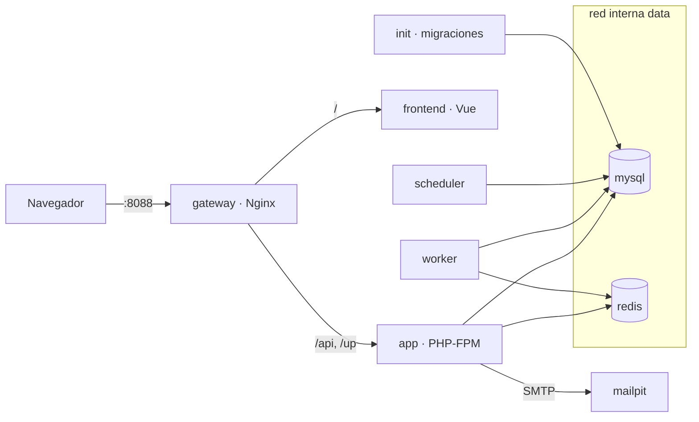

# Docker

Trazo corre completo en contenedores. En local basta con:

```bash
docker compose up -d
```

La aplicación queda en `http://localhost:8088` y los correos de prueba en `http://localhost:8025` (Mailpit). No hace falta crear un `.env`: los valores por defecto sirven para local. Si se necesita cambiar un puerto o una credencial local, se copia `.env.example` a `.env` y se ajusta.

## Servicios



| Servicio | Imagen | Función |
|---|---|---|
| `gateway` | `nginx-unprivileged` 1.30 | Única entrada pública. `/api` y `/up` van a Laravel; el resto, al frontend. Agrega las cabeceras de seguridad. |
| `app` | `trazo/api` (PHP 8.4 FPM) | API de Laravel 13 |
| `init` | `trazo/api` | Corre una vez antes que la API: migraciones y seeders. Si falla, la API no arranca. |
| `worker` | `trazo/api` | Procesa las colas |
| `scheduler` | `trazo/api` | Tareas programadas |
| `frontend` | `trazo/web` | En local, Vite con recarga en caliente. En producción, el build servido por Nginx sin root. |
| `mysql` | MySQL 8.4 | Base de datos (`trazo` y `trazo_test` para pruebas) |
| `redis` | Redis 8.4 | Caché y colas |
| `mailpit` | Mailpit | Buzón de correo local (solo en local) |

## Archivos

| Archivo | Para qué |
|---|---|
| `docker-compose.yml` | Base común a todos los entornos |
| `docker-compose.override.yml` | Local: se carga solo. Monta el código, usa Vite y agrega Mailpit. |
| `docker-compose.prod.yml` | Despliegue (se agrega en la fase de despliegue) |
| `docker/php/` | Imagen de Laravel, configuración de PHP-FPM, arranque y healthcheck |
| `docker/frontend/` | Imagen del frontend y su servidor estático |
| `docker/nginx/` | Configuración del gateway y cabeceras de seguridad |
| `docker/mysql/init/` | Creación de la base de pruebas en el primer arranque |

## Decisiones de diseño

- **Un solo origen.** El navegador habla solo con el gateway, así que no hay CORS y la superficie expuesta es mínima.
- **Red interna para datos.** MySQL y Redis están en la red `data`, marcada como interna: no tienen puertos publicados ni salida a internet.
- **Una imagen para cuatro servicios.** `app`, `init`, `worker` y `scheduler` usan la misma imagen; no se repite configuración y todos ejecutan exactamente el mismo código.
- **Sin root.** PHP-FPM, el frontend y el gateway corren con usuarios sin privilegios.
- **Versiones fijas.** Todas las imágenes base tienen versión exacta.
- **Builds multi-etapa.** La imagen de producción no lleva Composer ni herramientas de compilación.
- **Arranque ordenado.** Cada servicio espera a que sus dependencias estén *sanas* (healthcheck), no solo iniciadas.
- **Configuración de MySQL como parámetros.** Charset `utf8mb4_0900_ai_ci`, zona horaria UTC, registro de consultas lentas (más de 1 s) e índices FULLTEXT desde 3 letras se pasan al arrancar el contenedor. MySQL descarta por seguridad los archivos `.cnf` montados con permisos amplios, que es lo que ocurre en Windows y macOS.

## Entorno local en Windows y macOS

El código se monta desde el disco del equipo, y en estos sistemas llega al contenedor sin permiso de escritura para el usuario sin privilegios. Por eso, en local, `init` arranca como root solo para ajustar los permisos de `vendor/`, `storage/` y `bootstrap/cache/`; la instalación de dependencias y las migraciones corren como `www-data`.

El script de arranque local (`docker/php/dev-init.sh`) también se monta desde el repositorio en vez de copiarse a la imagen. Docker no reconstruye una imagen que ya existe, así que con el script copiado, un equipo con una imagen anterior seguía usando la versión vieja: migraba pero no cargaba los datos de prueba. Montado, siempre corre la versión actual.

Las dependencias de PHP (`vendor/`) no se leen desde la carpeta del equipo sino desde un volumen de Docker (`trazo_vendor`). PHP abre cientos de archivos de `vendor/` en cada petición, y leerlos a través de la carpeta compartida de Windows es lento: con el volumen, cada petición bajó de varios segundos a menos de uno, y arrancar Laravel desde la consola, de 26 s a poco más de 1 s. `init` instala las dependencias en ese volumen con `composer install`. La carpeta `backend/vendor/` del equipo, si existe, ya no la usa ningún contenedor; sirve solo para el editor.

Para reinstalar las dependencias desde cero: `docker compose -p trazo down`, `docker volume rm trazo_vendor` y `docker compose up -d`.

Si los builds fallan con errores como `no such host` o `TLS: unspecified error`, el problema suele ser un DNS inestable en la red local. Se resuelve agregando `"dns": ["1.1.1.1", "8.8.8.8"]` en *Docker Desktop → Settings → Docker Engine*.

## Gateway y contenedores que se recrean

El gateway vuelve a consultar el DNS interno de Docker (`resolver 127.0.0.11` y `resolve` en cada upstream). Así, si la API o el frontend se recrean con otra IP, el gateway los sigue encontrando sin reiniciarse.

## Frontend en desarrollo

- Vite corre con un límite de 1 GB de memoria (el Nginx de producción usa 128 MB).
- En Windows y macOS los cambios de archivos montados no llegan al contenedor como eventos, así que Vite los revisa por sondeo (`VITE_USE_POLLING`).
- Mientras Vite arranca (unos segundos), el gateway puede responder 502: basta con recargar.

## Llave de cifrado (`APP_KEY`)

La llave cifra datos sensibles, como los secretos del MFA; si se pierde, esos datos no se pueden recuperar.

- **En local** se genera sola la primera vez y se guarda en el volumen `trazo_app-key`. No hay que hacer nada.
- **En producción** debe definirse en el entorno del servidor y respaldarse. Si falta, los contenedores se niegan a arrancar.

## Convivencia con otros proyectos

En la misma máquina pueden correr otros proyectos con Docker. Para no interferir:

- El proyecto se llama siempre `trazo`: contenedores, redes y volúmenes llevan ese prefijo.
- Solo se publican dos puertos en el host, ambos configurables: `8088` (aplicación) y `8025` (Mailpit, solo local).
- Cada contenedor tiene límites de CPU y memoria.
- Todos los comandos se limitan al proyecto (`docker compose -p trazo ...`). No se usan comandos globales como `docker system prune` o `docker volume prune`.

## Comandos frecuentes

| Para | Comando |
|---|---|
| Levantar todo | `docker compose up -d` |
| Ver el estado | `docker compose ps` |
| Ver los logs de la API | `docker compose logs -f app` |
| Ejecutar un comando de Laravel | `docker compose exec app php artisan <comando>` |
| Detener sin borrar datos | `docker compose down` |
| Borrar también los datos de Trazo | `docker compose down -v` (solo afecta volúmenes de Trazo) |

## Dónde está en el código

- [`docker-compose.yml`](../../docker-compose.yml) y [`docker-compose.override.yml`](../../docker-compose.override.yml)
- [`docker/php/Dockerfile`](../../docker/php/Dockerfile), [`entrypoint.sh`](../../docker/php/entrypoint.sh), [`dev-init.sh`](../../docker/php/dev-init.sh) y [`healthcheck.sh`](../../docker/php/healthcheck.sh)
- [`docker/nginx/gateway.conf`](../../docker/nginx/gateway.conf) y [`snippets/security-headers.conf`](../../docker/nginx/snippets/security-headers.conf)
- [`docker/frontend/Dockerfile`](../../docker/frontend/Dockerfile)
- [`docker/mysql/init/01-test-database.sh`](../../docker/mysql/init/01-test-database.sh)
- Decisiones: [ADR-0025](../decisiones/0025-docker.md) y [ADR-0038](../decisiones/0038-versiones-del-stack.md)
- Validación en el CI: [Integración continua](integracion-continua.md)
