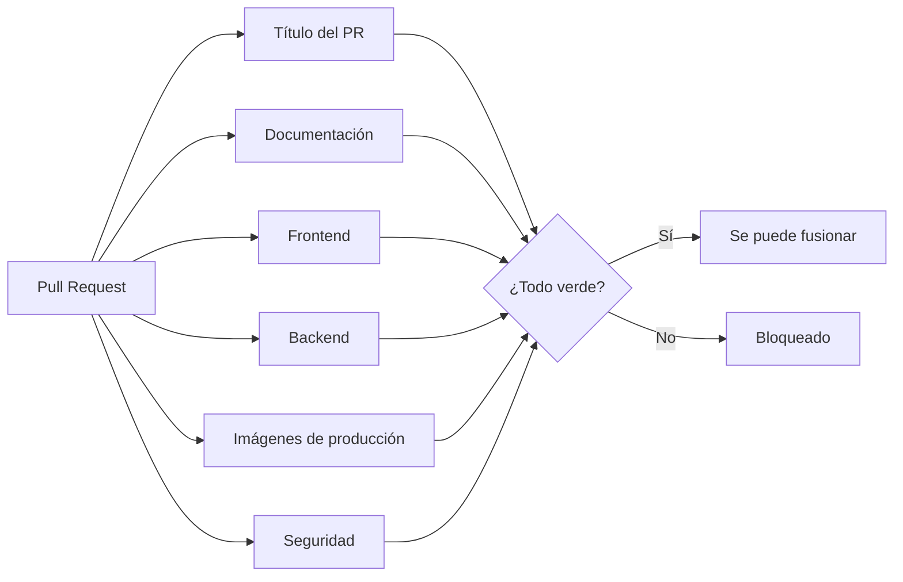

# Integración continua

Cada Pull Request hacia `dev`, `stage` o `main`, y cada llegada a esas ramas, corre el flujo de [GitHub Actions](https://docs.github.com/actions) de `.github/workflows/ci.yml`. Si un trabajo falla, el PR no se fusiona.

## Trabajos

Los trabajos corren en paralelo.

| Trabajo | Qué valida |
|---|---|
| **Título del PR** | Que siga Conventional Commits, porque al fusionar con squash el título se vuelve el mensaje del commit. Usa el mismo script que el hook local. |
| **Documentación** | Que los enlaces relativos de `docs/` apunten a archivos que existen, y que cada documento citado en el encabezado de un archivo de código exista. |
| **Frontend** | `npm run check` (tipos, ESLint, Stylelint, Prettier y Vitest) y el build de producción. |
| **Backend** | Levanta el stack de Docker completo, igual que en local, y corre `composer check` (Pint, Larastan y Pest contra MySQL real). Al final comprueba que el gateway responda en `/up` y en `/`. |
| **E2E** | Levanta el stack completo, instala Chromium y corre los flujos críticos de Playwright en las cuatro vistas, con revisión de accesibilidad (axe). Cada falla queda anotada en el PR. Ver [Estrategia de pruebas](../calidad/estrategia-de-pruebas.md). |
| **Imágenes de producción** | Que las imágenes `prod` de la API y del frontend se construyan. Son las que el despliegue publicará en GHCR. |
| **Seguridad** | Gitleaks sobre todo el historial, `composer audit` y `npm audit`. |

## Auditoría de dependencias

| Qué | Bloquea |
|---|---|
| Dependencias del backend (`composer audit`) | Sí |
| Dependencias del frontend que llegan al navegador (`npm audit --omit=dev`) | Sí, desde severidad alta |
| Herramientas de desarrollo del frontend (lint, pruebas, build) | No: se muestran como aviso en el resumen del CI |
| Dependencias de la raíz (hooks de Git) | Sí, desde severidad alta |

Las herramientas de desarrollo no se publican ni procesan datos de usuarios; solo corren sobre el código del propio repositorio. Bloquear el CI por un aviso suyo sin corrección disponible detendría todo el trabajo sin reducir el riesgo real. Aun así, quedan visibles en cada corrida y Dependabot propone la corrección en cuanto existe.

## Seguridad del propio CI

- **Permisos mínimos.** El flujo solo puede leer el repositorio (`permissions: contents: read`).
- **Acciones fijadas por commit.** Cada acción externa se referencia por su hash completo y no por una etiqueta, que su autor podría mover. Un comentario indica la versión.
- **Sin credenciales persistidas.** El checkout no deja el token de GitHub guardado en el disco del runner.
- **Sin inyección.** El título del PR llega al script como variable de entorno y nunca se interpola en el comando.
- **Corridas que no se acumulan.** Un push nuevo al mismo PR cancela la corrida anterior.

## Secretos antes del commit

El repositorio es público, así que un secreto no puede llegar ni siquiera al historial local, porque después se publicaría con él. Por eso Gitleaks también corre en el hook `pre-commit`, sobre los cambios preparados, y bloquea el commit si encuentra algo. Usa la misma imagen de Docker que el CI, así que no hace falta instalarlo.

## Dependabot

`.github/dependabot.yml` revisa cada lunes las dependencias de Composer, npm (frontend y raíz), las imágenes de los Dockerfile y del compose, y las acciones de GitHub. Abre los PR hacia `dev`, agrupa las actualizaciones menores y de parche en uno solo, y cada PR pasa por el mismo CI que cualquier cambio.

## Reproducirlo en local

Mientras el repositorio no esté publicado, estas validaciones se corren en local antes de cada fusión:

| Trabajo | Comando |
|---|---|
| Documentación | `node scripts/docs/check-links.mjs` |
| Frontend | `npm run check` y `npm run build` (en `frontend/`) |
| Backend | `docker compose -p trazo exec app composer check` (con el modo desarrollo arriba) |
| E2E | `npm run test:e2e` (en `frontend/`, con el stack arriba) |
| Imágenes de producción | `docker compose -p trazo -f docker-compose.yml build` |
| Secretos | `node scripts/git/scan-secrets.mjs` (cambios preparados); el CI revisa todo el historial |
| Validar el flujo | `docker run --rm -v "<ruta del repo>:/repo" -w /repo rhysd/actionlint:1.7.12` |

## Dónde está en el código

- [`.github/workflows/ci.yml`](../../.github/workflows/ci.yml): el flujo completo.
- [`.github/dependabot.yml`](../../.github/dependabot.yml): actualizaciones automáticas.
- [`scripts/docs/check-links.mjs`](../../scripts/docs/check-links.mjs): validación de enlaces.
- [`scripts/git/scan-secrets.mjs`](../../scripts/git/scan-secrets.mjs) y [`lefthook.yml`](../../lefthook.yml): secretos antes del commit.
- [`scripts/git/check-commit-msg.mjs`](../../scripts/git/check-commit-msg.mjs): formato del mensaje y del título del PR.
- Decisiones: [ADR-0034](../decisiones/0034-ci-cd.md) y [ADR-0041](../decisiones/0041-ci-con-el-stack-de-docker.md).
