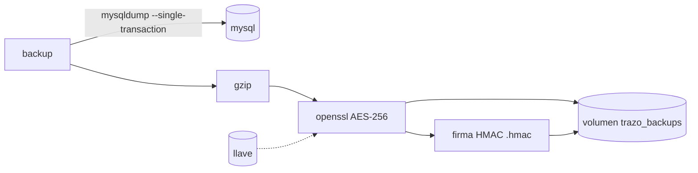

# Respaldos

El servicio `backup` hace una copia completa de la base de Trazo **cada día a las 3:00 (hora de Bogotá)** y guarda los últimos **7 días**. Corre solo, en local y en el despliegue, desde que se levanta el stack.

Cada respaldo es un volcado de MySQL comprimido y cifrado con AES-256, con una firma al lado. Sin la llave no se puede abrir, y si alguien lo modifica, la restauración lo rechaza.

## Cómo funciona



- **No bloquea la app:** el volcado lee una foto consistente de la base mientras la app sigue funcionando.
- **Mínimo privilegio:** usa el usuario de la base de la app (no root) y solo la red interna `data`.
- **Al arrancar:** si no hay un respaldo de las últimas 24 horas, hace uno de inmediato. Por eso, en un equipo nuevo, el primer respaldo aparece a los pocos segundos de `docker compose up -d`.
- **Reintentos:** el servicio revisa cada 5 minutos si le toca un respaldo, en vez de dormir hasta la hora. Si falla (por ejemplo, MySQL todavía no acepta conexiones porque Docker se reinició y levantó los contenedores en otro orden), lo vuelve a intentar en la revisión siguiente. Si el equipo estaba apagado o suspendido a las 3:00, el respaldo de ese día se hace en cuanto vuelve.
- **Salud:** el contenedor aparece como *unhealthy* si el último respaldo tiene más de 26 horas. Es la señal de que algo falla (`docker compose -p trazo logs backup` dice qué).

Cada respaldo son dos archivos, por ejemplo:

```
trazo-20261026T081500Z.sql.gz.enc        el volcado cifrado (fecha en UTC)
trazo-20261026T081500Z.sql.gz.enc.hmac   su firma
```

## La llave

| Entorno | Dónde está |
|---|---|
| Local | Se genera sola la primera vez y queda en el volumen `trazo_backup-key`. No hay que hacer nada. |
| Producción | `BACKUP_ENCRYPTION_KEY` en el entorno del servidor. Es obligatoria: sin ella el servicio no arranca. |

Para crear una llave de producción:

```bash
openssl rand -base64 32
```

**Guárdala fuera del servidor**, junto a la `APP_KEY` (por ejemplo, en el gestor de contraseñas del equipo). Si el servidor se pierde y la llave también, los respaldos no sirven de nada.

## Variables

| Variable | Por defecto | Para qué |
|---|---|---|
| `BACKUP_ENCRYPTION_KEY` | vacía (local) | Llave de cifrado. Obligatoria en producción. |
| `BACKUP_AT` | `03:00` | Hora del respaldo diario |
| `BACKUP_TIMEZONE` | `America/Bogota` | Zona horaria de esa hora |
| `BACKUP_RETENTION_DAYS` | `7` | Días que se guardan |
| `BACKUP_CHECK_SECONDS` | `300` | Cada cuánto revisa si toca un respaldo (y reintenta uno fallido) |

## Comandos

| Para | Comando |
|---|---|
| Ver los respaldos | `docker compose -p trazo exec backup trazo-backup list` |
| Hacer uno ahora | `docker compose -p trazo exec backup trazo-backup run` |
| Ver si está sano | `docker compose -p trazo ps backup` |
| Ver qué hizo | `docker compose -p trazo logs backup` |

En Git Bash (Windows), antepón `MSYS_NO_PATHCONV=1` a los comandos que llevan rutas.

## Restaurar

La restauración revisa primero la firma. Si el archivo está dañado, fue modificado o se cifró con otra llave, se detiene sin tocar nada.

### Probar un respaldo sin tocar la base principal

Es lo que conviene hacer de vez en cuando: un respaldo que nunca se probó no es un respaldo.

En local, la base de pruebas `trazo_test` sirve de destino. Las pruebas automáticas la recrean al correr, así que no se pierde nada:

```bash
docker compose -p trazo exec backup trazo-backup restore trazo-20261026T081500Z.sql.gz.enc trazo_test
```

En el servidor, crea antes una base aparte con root y dale acceso al usuario de la app:

```bash
docker compose -p trazo exec mysql sh -c 'mysql -uroot -p"$MYSQL_ROOT_PASSWORD" -e "CREATE DATABASE trazo_restore; GRANT ALL ON trazo_restore.* TO \"$MYSQL_USER\"@\"%\";"'
docker compose -p trazo exec backup trazo-backup restore <archivo> trazo_restore
```

Compara después algunos conteos (incidentes, historial, usuarios) con la base principal y borra `trazo_restore`.

### Restaurar la base principal

1. Activa el **modo mantenimiento** en *Sistema → Salud*, para que nadie escriba mientras tanto ([Panel de sistema](sistema.md)).
2. Detén los procesos que escriben solos: `docker compose -p trazo stop worker scheduler`.
3. Restaura:
   ```bash
   docker compose -p trazo exec backup trazo-backup restore <archivo> trazo
   ```
4. Vuelve a levantarlos: `docker compose -p trazo start worker scheduler`.
5. Limpia la caché de datos y desactiva el modo mantenimiento desde *Sistema → Salud*.

Todo lo que pasó entre la hora del respaldo y la restauración se pierde. Por eso conviene, antes de restaurar, hacer un respaldo del estado actual con `trazo-backup run`.

## Lo que no cubre

- **Copia fuera del servidor:** los respaldos viven en un volumen del mismo servidor. Si se pierde el disco, se pierden con él. Está en las [mejoras propuestas](../mejoras/propuestas.md).
- **Recuperación al minuto:** con un respaldo diario se puede perder hasta un día de datos. Los binlogs de MySQL lo bajarían a minutos; también está en las propuestas.
- **Redis:** no se respalda. Guarda caché, colas y contadores de seguridad, que se reconstruyen solos. Los jobs que estaban en la cola sí se perderían.

## Dónde está en el código

- [`docker/mysql/backup.sh`](../../docker/mysql/backup.sh): todo el respaldo (`schedule`, `run`, `list`, `check` y `restore`).
- [`docker-compose.yml`](../../docker-compose.yml): servicio `backup` y volúmenes `backups` y `backup-key`.
- [`.env.example`](../../.env.example): variables `BACKUP_*`.
- Decisión: [ADR-0064](../decisiones/0064-respaldo-diario-de-mysql.md).
