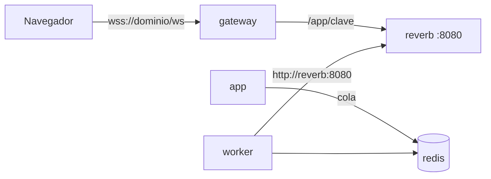

# Tiempo real (Reverb)

Reverb es el servidor de websockets de Laravel. En Trazo corre en el servicio `reverb`, con la misma imagen de la API, y solo se llega a él por el gateway.

1. Un cambio en la app emite el aviso; va a la cola en Redis.
2. El worker se lo entrega a Reverb por la red interna.
3. Reverb lo reparte a los navegadores suscritos a cada canal.

## Gateway

`location /ws/` en `docker/nginx/gateway.conf` pasa la conexión a Reverb con `Upgrade` y quita el prefijo: `/ws/app/<clave>` llega como `/app/<clave>`. La conexión queda abierta: Reverb manda un ping cada 60 s y el gateway espera hasta 120 s sin tráfico. Reverb no publica puerto en el host.

## Variables

| Variable | Local | Producción |
|---|---|---|
| `REVERB_APP_ID` | `trazo` | Obligatoria |
| `REVERB_APP_KEY` | `trazo-local-key` | Obligatoria. Es pública: el navegador la recibe por `GET /api/v1/realtime` |
| `REVERB_APP_SECRET` | `trazo_local_only` | Obligatoria y secreta: firma las suscripciones. Solo en el entorno, nunca en el repositorio |
| `REVERB_ALLOWED_ORIGINS` | `localhost` | El dominio de la app, sin esquema (p. ej. el subdominio de producción) |

Las fija el `docker-compose.yml` para todos los servicios de Laravel, junto con:

- `BROADCAST_CONNECTION=reverb`.
- `REVERB_HOST=reverb`, `REVERB_PORT=8080` y `REVERB_SCHEME=http`: la app le habla por la red interna.

## Protecciones

- Solo acepta conexiones desde `REVERB_ALLOWED_ORIGINS`. Otro origen recibe el error 4009, "Origin not allowed".
- Los navegadores no pueden mandarse eventos entre sí (`accept_client_events_from: none`).
- Cada mensaje tiene un máximo de 2 KB, y cada conexión, de 60 mensajes por minuto; si los supera, se corta.
- Cada canal es privado. La firma la da la API solo con sesión completa y si los permisos lo permiten.
- En producción va por `wss` con el mismo certificado del dominio, porque pasa por el gateway.

## Revisar que funcione

- `docker compose -p trazo ps reverb`: debe estar `healthy`. El healthcheck abre una conexión al puerto 8080.
- En el navegador, la pestaña de red debe mostrar `ws(s)://<dominio>/ws/app/…` con estado 101 y peticiones `POST /api/v1/broadcasting/auth` con 200.
- Si no llegan avisos, mirar `docker compose -p trazo logs worker` y `logs reverb`. El worker es quien entrega los avisos.
- Después de cambiar código de Laravel, reiniciar `reverb` y `worker`: son procesos largos que no recargan el código solos.

## Dónde está en el código

- [`docker-compose.yml`](../../docker-compose.yml) (servicio `reverb` y variables) y [`docker-compose.dev.yml`](../../docker-compose.dev.yml)
- [`docker/nginx/gateway.conf`](../../docker/nginx/gateway.conf)
- [`backend/config/reverb.php`](../../backend/config/reverb.php) y [`backend/config/broadcasting.php`](../../backend/config/broadcasting.php)
- Decisión: [ADR-0057](../decisiones/0057-tiempo-real-en-la-practica.md)
