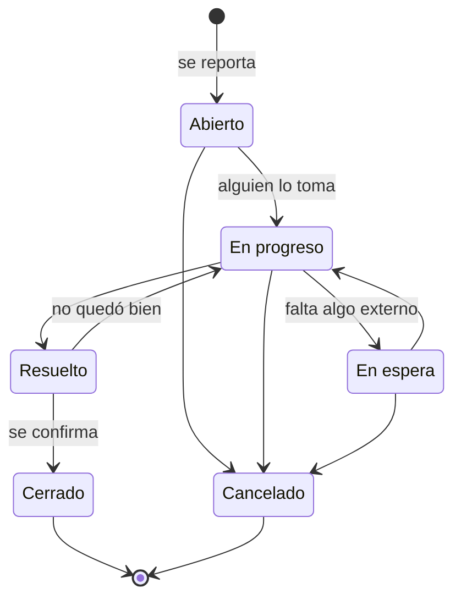

# Ciclo de vida de un incidente

Un incidente avanza por estados desde que se reporta hasta que se cierra. No se puede saltar de cualquier estado a cualquier otro: cada estado tiene sus siguientes pasos permitidos. Así los datos y las cifras del resumen siempre tienen sentido.

## Estados

| Estado | Qué significa | Se puede pasar a |
|---|---|---|
| **Abierto** | Recién reportado; todavía nadie trabaja en él | En progreso o Cancelado |
| **En progreso** | Alguien lo está atendiendo | En espera, Resuelto o Cancelado |
| **En espera** | Está detenido por algo externo: una respuesta, un repuesto, una autorización | En progreso o Cancelado |
| **Resuelto** | Se dio una solución y falta confirmarla | Cerrado, o En progreso si la solución no funcionó |
| **Cerrado** | Terminado y confirmado | Es final: solo se reabre con aprobación |
| **Cancelado** | Se descartó (duplicado, no aplica, se reportó por error) | Es final: solo se reabre con aprobación |

Abierto, En progreso y En espera son los estados **pendientes**: el caso todavía requiere trabajo.

Al pasar a **Resuelto** queda la fecha de resolución, con la que se mide cuánto tardan los casos. Si vuelve a En progreso, esa fecha se borra. Pasar a un estado final (Cerrado o Cancelado) pide confirmación.

**Cada cambio de estado se puede explicar con una nota**, que queda en el historial. Al pasar a **Resuelto** es obligatorio contar cómo se resolvió, y al **cancelar**, por qué. En los demás cambios es opcional.

## Reabrir un incidente

Lo cerrado o cancelado no vuelve atrás con un simple cambio de estado: así un cierre significa algo y las cifras son confiables. Si el problema volvió o algo se cerró por error:

1. Quien atiende o quien reportó usa **"Solicitar reapertura"** y escribe por qué.
2. Supervisor o Super admin ve la solicitud en el detalle y en la vista previa del listado (en el listado aparece marcada como "Reapertura pendiente" y se puede filtrar) y la **aprueba** o la **rechaza** con un motivo. Nadie decide su propia solicitud.
3. Al aprobarla, el incidente vuelve a **En progreso** si tiene responsable, o a **Abierto** si no, con un vencimiento nuevo según su prioridad.

Supervisor y Super admin también pueden **reabrir directamente**, escribiendo el motivo. Todo queda en el historial: quién pidió, quién decidió y por qué.

## Prioridades y vencimiento

| Prioridad | Tiempo sugerido para resolver |
|---|---|
| Baja | 5 días |
| Media | 3 días |
| Alta | 1 día |
| Crítica | 4 horas |

Al reportar, la fecha de vencimiento se sugiere sola con el tiempo de la prioridad, y la persona puede cambiarla. Si la deja vacía, el sistema la calcula. La fecha no puede quedar en el pasado. Los tiempos por prioridad son datos que se pueden ajustar sin modificar el sistema.

**Vencido** no es un estado: es una señal. Un incidente está vencido cuando su fecha de vencimiento ya pasó y sigue pendiente. Se marca en rojo en el listado y en el detalle, se puede filtrar con "Solo vencidos" y se cuenta en el resumen. En cuanto se resuelve, deja de estar vencido.

## Quién mueve cada paso

| Paso | Quién |
|---|---|
| Reportar | Cualquier persona |
| Editar título, descripción, prioridad o vencimiento | Quien lo reportó, solo mientras está en Abierto. Supervisor y Super admin, en cualquier estado no final |
| Tomarlo (asignárselo a sí mismo) | Agente, Supervisor y Super admin, si no tiene responsable |
| Asignarlo o reasignarlo a otra persona | Supervisor y Super admin |
| Cambiar el estado | Quien lo tiene asignado, y Supervisor y Super admin en cualquier caso |
| Pedir que se reabra | Quien puede verlo, cuando está cerrado o cancelado |
| Aprobar o rechazar una reapertura, o reabrir directamente | Supervisor y Super admin |
| Eliminar o restaurar | Supervisor y Super admin |

Un incidente eliminado no se borra: sale de los listados y del resumen, pero se puede ver con el filtro "Ver eliminados" y restaurar. Su historial se conserva.

## Qué queda registrado

Cada paso deja una entrada en el **historial** del incidente: quién lo hizo, cuándo, qué cambió (por ejemplo, "cambió el estado de Abierto a En progreso") y la nota que dejó. El detalle los muestra en su **actividad**, junto a los mensajes, con un filtro para ver solo los cambios; "Ver actividad anterior" trae lo más viejo. El historial no se puede editar ni borrar. Quien puede ver el incidente puede ver su historial; la auditoría general, además, muestra desde qué dirección y navegador se hizo cada cambio.

## Si dos personas cambian lo mismo

Si alguien guarda cambios sobre un incidente que otra persona modificó mientras tanto, Trazo no pisa el cambio anterior. Avisa que el incidente cambió y ofrece recargarlo. Y si la otra persona lo cambia mientras alguien tiene el formulario abierto, aparece un aviso al momento, sin borrar lo que ya se escribió.

## Para profundizar

- [Roles y permisos](roles.md)
- Detalle técnico: [módulo Incidents](../backend/incidents.md) y [catálogos](../base-de-datos/diccionario/catalogos.md).
